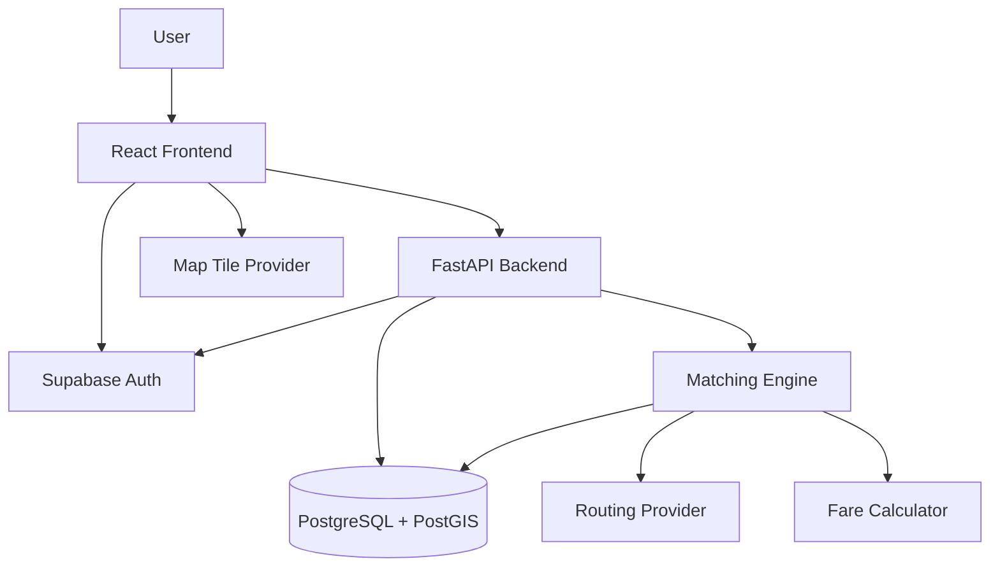
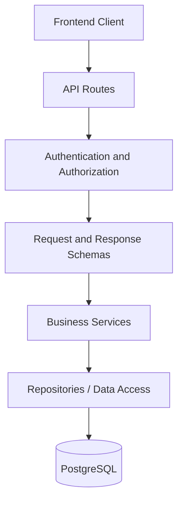
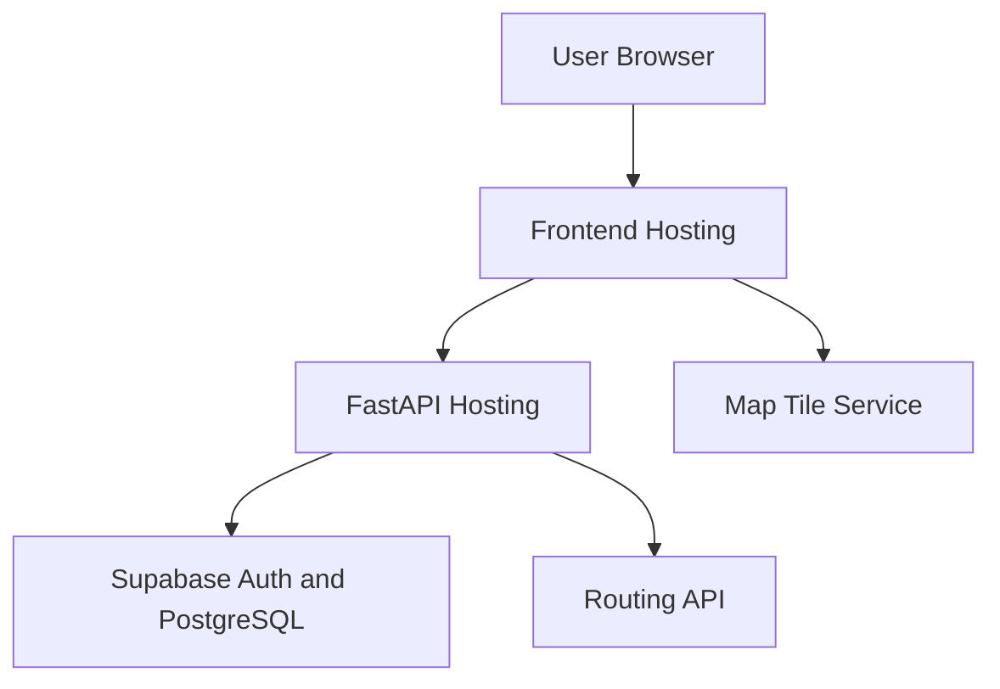

# Smart Share — System Architecture and Technical Design Document

**Document:** System Architecture & TDD  
**Version:** 1.0  
**Status:** Proposed Architecture  
**Project:** Smart Share

---

## 1. Purpose

This document defines the proposed technical architecture of Smart Share, including its components, responsibilities, data flow, technology choices, matching-engine design, routing integration, security considerations and deployment structure.

It serves as the technical reference for implementation.

## 2. Architectural Goals

The architecture must:

- Separate frontend, backend and database responsibilities.
- Keep business logic independent of UI components.
- Make matching logic independently testable.
- Support geospatial queries efficiently.
- Allow routing providers to be replaced.
- Protect data consistency during concurrent operations.
- Be practical for a two-developer hackathon team.
- Avoid unnecessary infrastructure complexity.

## 3. High-Level Architecture

Smart Share will use a client-server architecture.



### 3.1 Frontend

The frontend is responsible for:

- User interaction.
- Authentication interface.
- Location selection.
- Ride request forms.
- Match proposal display.
- Map visualization.
- Group status display.
- API communication.
- Client-side validation.

It must not independently decide whether a ride group is feasible. The backend remains authoritative.

### 3.2 Backend

The backend is responsible for:

- Authentication verification.
- Request validation.
- Business rules.
- Database operations.
- Candidate discovery.
- Matching and group construction.
- Routing-provider communication.
- Fare calculation.
- Group lifecycle management.
- Authorization and error handling.

### 3.3 Database

PostgreSQL stores application data.

PostGIS provides geospatial data types, indexes and spatial queries.

### 3.4 External Services

External services may include:

- Supabase Auth.
- Map tile provider.
- Geocoding provider.
- Road-routing provider.

External services must be accessed through dedicated service modules rather than directly from unrelated application components.

---

## 4. Proposed Technology Stack

| Component | Technology | Purpose |
|---|---|---|
| Frontend | React | UI |
| Build Tool | Vite | Development and build |
| Language | TypeScript | Type safety |
| Styling | Tailwind CSS | Styling |
| Components | shadcn/ui | Reusable UI |
| Routing | React Router | Frontend navigation |
| Server State | TanStack Query | API state |
| Validation | Zod | Client-side schemas |
| Backend | FastAPI | REST API |
| Backend Language | Python | Business logic |
| Validation | Pydantic | Request/response schemas |
| ORM | SQLAlchemy 2 | Database access |
| Migrations | Alembic | Schema versioning |
| Database | PostgreSQL | Persistent storage |
| Spatial Extension | PostGIS | Geospatial queries |
| Authentication | Supabase Auth | Identity management |
| Maps | Leaflet | Map rendering |
| Routing | External routing API | Road routes and ETA |
| Backend Tests | Pytest | Unit and integration tests |
| Frontend Tests | Vitest | Component and utility tests |
| E2E Tests | Playwright | User workflow testing |

All dependencies must be confirmed and pinned to compatible versions during repository setup.

---

## 5. Backend Architecture

The backend should follow a layered structure.



### 5.1 API Layer

Responsibilities:

- Define HTTP endpoints.
- Parse request data.
- Validate input using schemas.
- Invoke service functions.
- Return consistent responses.
- Apply authentication and authorization dependencies.

API route handlers should remain thin. Complex business logic must not be placed directly inside endpoint functions.

### 5.2 Service Layer

Responsibilities:

- Implement application rules.
- Coordinate multiple repositories.
- Manage transactions.
- Invoke matching and routing modules.
- Enforce state transitions.

### 5.3 Repository Layer

Responsibilities:

- Encapsulate database operations.
- Execute queries.
- Handle persistence.
- Keep database-specific logic out of business services where practical.

### 5.4 Matching Module

Responsibilities:

- Discover candidate requests.
- Evaluate time compatibility.
- Evaluate route compatibility.
- Construct groups.
- Calculate scores.
- Rank proposals.

### 5.5 Routing Module

Responsibilities:

- Communicate with the selected routing provider.
- Retrieve route duration and distance.
- Handle provider errors.
- Cache suitable results where appropriate.
- Normalize provider responses.

### 5.6 Fare Module

Responsibilities:

- Estimate total shared journey cost.
- Allocate fare shares.
- Calculate savings.
- Return clearly labelled estimates.

---

## 6. Proposed Backend Directory Structure

```text
backend/
├── app/
│   ├── main.py
│   ├── api/
│   │   ├── dependencies.py
│   │   └── v1/
│   │       ├── router.py
│   │       └── endpoints/
│   ├── core/
│   │   ├── config.py
│   │   ├── security.py
│   │   ├── exceptions.py
│   │   └── logging.py
│   ├── models/
│   ├── schemas/
│   ├── services/
│   ├── repositories/
│   ├── matching/
│   │   ├── candidate_filter.py
│   │   ├── compatibility.py
│   │   ├── scoring.py
│   │   ├── group_builder.py
│   │   └── optimizer.py
│   ├── routing/
│   │   ├── base.py
│   │   ├── provider.py
│   │   └── cache.py
│   ├── fares/
│   │   ├── estimator.py
│   │   └── allocator.py
│   └── tests/
├── alembic/
├── pyproject.toml
└── README.md
```

The exact module names may change as implementation progresses, but responsibilities should remain separated.

---

## 7. Frontend Architecture

The frontend should use feature-oriented organization.

```text
frontend/
├── public/
└── src/
    ├── app/
    ├── components/
    │   ├── ui/
    │   └── shared/
    ├── features/
    │   ├── auth/
    │   ├── profile/
    │   ├── locations/
    │   ├── ride-requests/
    │   ├── matching/
    │   ├── ride-groups/
    │   └── maps/
    ├── hooks/
    ├── services/
    ├── lib/
    ├── types/
    ├── assets/
    └── main.tsx
```

### Frontend Responsibilities

- Display data received from the backend.
- Validate form input before submission.
- Manage loading and error states.
- Keep authentication tokens secure.
- Display map and route information.
- Refresh group and request status when needed.

The frontend must not be trusted to enforce capacity, authorization or route feasibility.

---

## 8. Matching Engine Design

### 8.1 Design Principles

The initial matching engine should be:

- Deterministic where possible.
- Explainable.
- Independently testable.
- Configurable.
- Constraint-driven.
- Efficient for a small hackathon dataset.

The MVP will use a rule-based heuristic rather than an unvalidated machine-learning model.

### 8.2 Candidate Discovery

The system first retrieves requests that satisfy preliminary conditions:

- Request is active.
- Request has not expired.
- Pickup is within the configured geographic radius.
- Departure windows overlap sufficiently.
- Request is not already assigned to another active group.
- Combined seat requirements may fit the configured capacity.

PostGIS spatial queries should be used for pickup proximity.

A proximity query is only a filtering step. It does not prove that two passengers can share a practical road route.

### 8.3 Time Compatibility

For requests A and B:

- A has departure interval `[A_start, A_end]`.
- B has departure interval `[B_start, B_end]`.

The overlap interval is:

`[max(A_start, B_start), min(A_end, B_end)]`

A valid overlap exists when:

`max(A_start, B_start) <= min(A_end, B_end)`

Additional coordination rules may require a minimum overlap duration.

### 8.4 Route Compatibility

The routing module must evaluate road routes and travel times.

For each proposed group:

1. Identify all pickup and drop-off stops.
2. Generate feasible stop sequences.
3. Request road-route estimates.
4. Calculate the total group journey.
5. Calculate each passenger's journey.
6. Compare each passenger's journey against their individual baseline.
7. Reject combinations that violate detour constraints.

Straight-line distance must not be used as a substitute for road distance.

### 8.5 Compatibility Scoring

Initial scoring model:

`S = 0.20P + 0.15T + 0.35R + 0.30E`

Where:

- P: pickup proximity.
- T: departure-time compatibility.
- R: route compatibility.
- E: travel efficiency and savings.

Each score is normalized between 0 and 1.

Weights are configurable and require testing.

Hard constraints such as capacity, request eligibility and maximum detour must be enforced independently of this score.

### 8.6 Group Construction

Initial approach: deterministic greedy heuristic.

1. Retrieve eligible candidate requests.
2. Generate promising pairs or small candidate groups.
3. Check hard constraints.
4. Evaluate route feasibility.
5. Add a request only when all group constraints remain valid.
6. Recalculate the route after additions.
7. Rank feasible groups.
8. Return the best available proposals.

The MVP should prioritize small group sizes to keep route evaluation manageable.

### 8.7 Route Optimization

For small groups, evaluate feasible pickup/drop-off permutations.

Constraints:

- A passenger's pickup must occur before their drop-off.
- All passengers must be picked up.
- All passengers must be dropped off.
- Capacity must remain valid.
- Departure and detour constraints must be respected.

The optimization objective may combine total journey duration, total distance and passenger-specific detours.

The system must document the objective function and avoid claiming global optimality unless the algorithm guarantees it.

---

## 9. Routing Provider Abstraction

The routing integration must be replaceable.

Proposed interface:

```python
class RoutingProvider:
    async def get_route(self, waypoints):
        """
        Return normalized route information:
        - distance
        - duration
        - geometry
        - waypoint order, if supported
        """
        raise NotImplementedError
```

The application should depend on this interface rather than a provider-specific response format.

### Failure Handling

If the provider is unavailable:

- Do not silently treat straight-line distance as road distance.
- Return a controlled error or mark the proposal as unavailable for route validation.
- Retry only when appropriate.
- Respect provider rate limits.
- Log failures without exposing API keys.

---

## 10. Fare Calculation Architecture

Fare calculation must be separate from route evaluation.

Inputs:

- Total estimated route distance.
- Total estimated duration.
- Configured base fare.
- Per-distance cost.
- Per-time cost, if applicable.
- Other configured cost components.
- Passenger-specific distance or journey contribution.

A possible total estimate:

`Total Estimate = Base Component + Distance Component + Time Component`

The fare allocation policy must be explicit and consistently applied.

For passenger i:

`Savings_i = Individual Estimate_i - Shared Fare Share_i`

The interface must show that these are estimates and not guaranteed quotes.

---

## 11. Database and Transaction Consistency

The database must enforce critical invariants.

Examples:

- One active group membership per ride request.
- Group capacity cannot be exceeded.
- A request cannot be accepted twice into different groups.
- Group membership changes must be atomic.
- Group state transitions must be validated.

Acceptance operations must use transactions and appropriate row locking or equivalent concurrency protection.

A partial unique index or another robust database-level mechanism should enforce the active-membership invariant.

Do not rely only on frontend checks.

---

## 12. Authentication and Authorization

Supabase Auth is proposed for identity management.

The backend must:

1. Receive the access token.
2. Validate its signature and relevant claims using the supported Supabase verification mechanism.
3. Extract the authenticated user ID.
4. Apply authorization checks to the requested resource.
5. Reject invalid or expired tokens.

The frontend must never contain a Supabase service-role key.

The precise token-verification configuration must be finalized during implementation based on the selected Supabase project settings.

---

## 13. API Communication

- REST API under `/api/v1`.
- JSON request and response bodies.
- Bearer-token authentication for protected endpoints.
- Standard HTTP status codes.
- Consistent error format.
- OpenAPI documentation generated by FastAPI.

Initial response convention:

```json
{
  "data": {},
  "message": "Operation completed successfully"
}
```

Initial error convention:

```json
{
  "error": {
    "code": "RESOURCE_NOT_FOUND",
    "message": "The requested resource was not found"
  }
}
```

---

## 14. Logging and Monitoring

The backend should log:

- Request ID.
- Endpoint.
- Response status.
- Processing duration.
- Matching operation ID.
- Number of candidates evaluated.
- Routing-provider failures.
- Transaction conflicts.

Logs must not expose access tokens, passwords, API keys or unnecessary personal location data.

---

## 15. Testing Strategy

### Unit Tests

Test:

- Coordinate validation.
- Time-window overlap.
- Pickup proximity filtering.
- Capacity checks.
- Compatibility scores.
- Detour calculation.
- Fare allocation.
- Group state transitions.

### Integration Tests

Test:

- Database persistence.
- Authentication.
- Ride request lifecycle.
- Match creation.
- Group acceptance.
- Cancellation.
- Transaction behaviour.

### End-to-End Tests

Test:

- User authentication.
- Ride request creation.
- Match discovery.
- Proposal acceptance.
- Group status display.

### Concurrency Tests

Test:

- Two users accepting the final available seat.
- Duplicate acceptance.
- Concurrent cancellation and acceptance.
- One request being assigned to multiple proposed groups.

---

## 16. Deployment Architecture



Proposed deployment:

- Frontend: Vercel or equivalent.
- Backend: Render or equivalent.
- Database: Supabase PostgreSQL with PostGIS.
- Authentication: Supabase Auth.
- Routing: Selected external provider.

Deployment must include:

- HTTPS.
- Correct CORS configuration.
- Environment-specific secrets.
- Database migrations.
- Health-check endpoint.
- Error logging.
- API usage limits.

---

## 17. Architecture Decision Records

Major choices must be recorded in `docs/ADR/`.

Initial decisions to document:

- ADR-001: React + Vite + TypeScript frontend.
- ADR-002: FastAPI backend.
- ADR-003: PostgreSQL + PostGIS database.
- ADR-004: Supabase Auth.
- ADR-005: Routing-provider abstraction.
- ADR-006: Rule-based matching heuristic for MVP.
- ADR-007: Transaction-safe group acceptance.

Each ADR should include:

- Context.
- Decision.
- Alternatives considered.
- Consequences.
- Date and status.

---

## 18. Technical Risks

| Risk | Technical Mitigation |
|---|---|
| Routing-provider limits | Cache results and minimize requests |
| Incorrect route assumptions | Use road-route data |
| Concurrent acceptance | Database transactions and constraints |
| Matching complexity | Restrict MVP group size |
| Authentication errors | Centralized token verification |
| Database inconsistency | Migrations and integrity constraints |
| External service downtime | Timeouts and graceful failure |

---

## 19. Technical Completion Criteria

The architecture is considered implemented when:

- Frontend and backend communicate successfully.
- Authentication is validated by the backend.
- Database migrations run successfully.
- Geospatial candidate discovery works.
- Matching logic is independently tested.
- Routing integration returns normalized results.
- Fare estimates are generated consistently.
- Group acceptance is transaction-safe.
- API documentation is available.
- The system can be deployed using documented configuration.

**Document Status:** Proposed Technical Design — Update this document whenever an approved architecture decision changes.