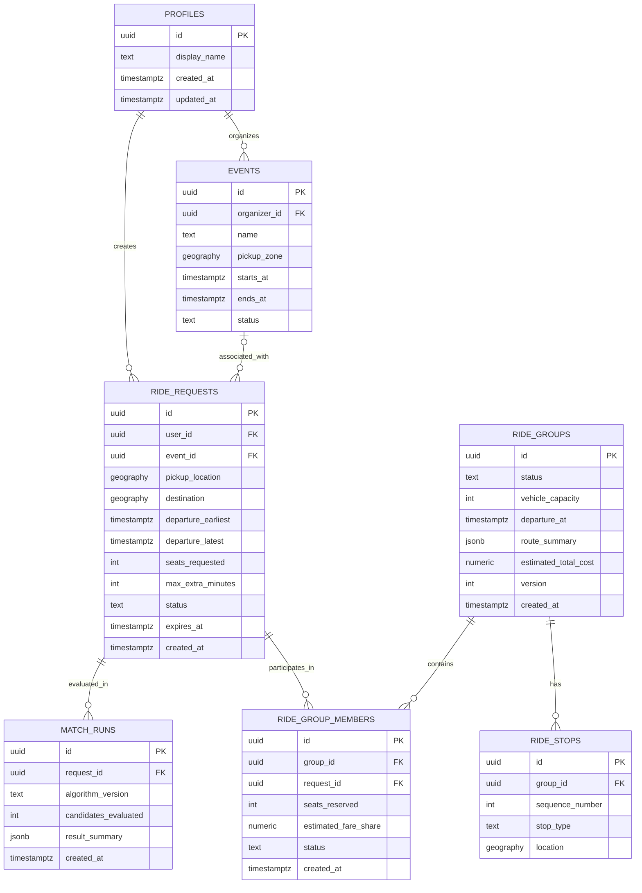

# Smart Share — Database Schema and API Contracts

**Document:** Database Schema & API Contracts  
**Version:** 1.0  
**Status:** Proposed — Pending Implementation Review

---

# Part A — Database Design

## 1. Database Overview

Smart Share will use PostgreSQL with the PostGIS extension.

PostgreSQL will store user profiles, ride requests, matching records, ride groups, memberships and route stops.

PostGIS will support spatial queries involving pickup and destination coordinates.

The database must maintain data integrity and prevent inconsistent group membership or seat allocation.

## 2. Core Entities

Initial entities:

1. `profiles`
2. `events`
3. `ride_requests`
4. `match_runs`
5. `ride_groups`
6. `ride_group_members`
7. `ride_stops`

Additional tables may be introduced for notifications, audit logs or saved preferences if required.

## 3. Entity Relationships



## 4. Table Specifications

### 4.1 `profiles`

Stores application-level user profile information.

| Column | Type | Constraints | Description |
|---|---|---|---|
| id | UUID | Primary key | Auth provider user ID |
| display_name | TEXT | Not null | User's display name |
| avatar_url | TEXT | Nullable | Profile image |
| created_at | TIMESTAMPTZ | Not null | Creation timestamp |
| updated_at | TIMESTAMPTZ | Not null | Last update |

The `id` should reference the identity maintained by the authentication provider, subject to the selected Supabase schema design.

### 4.2 `events`

Stores optional event information.

| Column | Type | Constraints | Description |
|---|---|---|---|
| id | UUID | Primary key | Event ID |
| organizer_id | UUID | Foreign key | Event organizer |
| name | TEXT | Not null | Event name |
| pickup_zone | GEOGRAPHY | Nullable | Event pickup area |
| starts_at | TIMESTAMPTZ | Not null | Start time |
| ends_at | TIMESTAMPTZ | Not null | End time |
| status | TEXT | Not null | Event status |
| created_at | TIMESTAMPTZ | Not null | Creation timestamp |

Event association is optional. Ordinary ride requests must work without an event.

### 4.3 `ride_requests`

Stores passenger travel requests.

| Column | Type | Constraints | Description |
|---|---|---|---|
| id | UUID | Primary key | Request ID |
| user_id | UUID | Foreign key, not null | Request owner |
| event_id | UUID | Foreign key, nullable | Associated event |
| pickup_location | GEOGRAPHY(Point, 4326) | Not null | Pickup coordinates |
| destination | GEOGRAPHY(Point, 4326) | Not null | Destination coordinates |
| pickup_label | TEXT | Nullable | Display label |
| destination_label | TEXT | Nullable | Display label |
| departure_earliest | TIMESTAMPTZ | Not null | Earliest departure |
| departure_latest | TIMESTAMPTZ | Not null | Latest departure |
| seats_requested | INTEGER | Positive | Required seats |
| max_extra_minutes | INTEGER | Non-negative | Detour preference |
| status | TEXT | Not null | Request state |
| expires_at | TIMESTAMPTZ | Nullable | Request expiry |
| created_at | TIMESTAMPTZ | Not null | Creation timestamp |
| updated_at | TIMESTAMPTZ | Not null | Last update |

Suggested request statuses:

- `ACTIVE`
- `MATCHED`
- `CANCELLED`
- `EXPIRED`
- `COMPLETED`

The final state model must be consistent with group membership rules.

### 4.4 `match_runs`

Stores matching execution metadata.

| Column | Type | Constraints | Description |
|---|---|---|---|
| id | UUID | Primary key | Matching run ID |
| request_id | UUID | Foreign key | Request initiating matching |
| algorithm_version | TEXT | Not null | Matching algorithm version |
| candidates_evaluated | INTEGER | Non-negative | Number of candidates |
| result_summary | JSONB | Nullable | Summary of evaluation |
| created_at | TIMESTAMPTZ | Not null | Execution timestamp |

Avoid storing unnecessary personal information in matching logs.

### 4.5 `ride_groups`

Stores proposed and confirmed passenger groups.

| Column | Type | Constraints | Description |
|---|---|---|---|
| id | UUID | Primary key | Group ID |
| status | TEXT | Not null | Group state |
| vehicle_capacity | INTEGER | Positive | Maximum seats |
| departure_at | TIMESTAMPTZ | Nullable | Proposed departure |
| route_summary | JSONB | Nullable | Route metadata |
| estimated_total_cost | NUMERIC(10,2) | Nullable | Estimated pooled cost |
| currency | CHAR(3) | Not null | Currency code |
| version | INTEGER | Not null | Optimistic version |
| created_at | TIMESTAMPTZ | Not null | Creation timestamp |
| updated_at | TIMESTAMPTZ | Not null | Last update |

The `route_summary` may contain normalized stop and route information. Canonical stop records should also be stored in `ride_stops`.

### 4.6 `ride_group_members`

Associates ride requests with ride groups.

| Column | Type | Constraints | Description |
|---|---|---|---|
| id | UUID | Primary key | Membership ID |
| group_id | UUID | Foreign key | Group |
| request_id | UUID | Foreign key | Passenger request |
| seats_reserved | INTEGER | Positive | Reserved seats |
| estimated_fare_share | NUMERIC(10,2) | Nullable | Estimated contribution |
| status | TEXT | Not null | Membership state |
| responded_at | TIMESTAMPTZ | Nullable | Response timestamp |
| created_at | TIMESTAMPTZ | Not null | Creation timestamp |

Suggested membership statuses:

- `INVITED`
- `ACCEPTED`
- `DECLINED`
- `WITHDRAWN`
- `CANCELLED`

A request must not have multiple active memberships. Enforce this through a database-level constraint or a transaction-safe equivalent. The definition of an active membership must be explicit and must allow historical membership records to remain stored.

### 4.7 `ride_stops`

Stores ordered route stops.

| Column | Type | Constraints | Description |
|---|---|---|---|
| id | UUID | Primary key | Stop ID |
| group_id | UUID | Foreign key | Ride group |
| sequence_number | INTEGER | Unique per group | Stop order |
| stop_type | TEXT | Not null | Pickup or drop-off |
| location | GEOGRAPHY(Point, 4326) | Not null | Stop coordinates |
| label | TEXT | Nullable | Display label |
| created_at | TIMESTAMPTZ | Not null | Creation timestamp |

Stop types:

- `PICKUP`
- `DROPOFF`

---

## 5. Indexing Strategy

Recommended indexes:

- Primary-key indexes on all entities.
- Index on `ride_requests.user_id`.
- Index on `ride_requests.status`.
- Index on `ride_requests.departure_earliest`.
- Index on `ride_requests.departure_latest`.
- GiST spatial index on pickup location.
- GiST spatial index on destination.
- Index on `ride_group_members.group_id`.
- Index on `ride_group_members.request_id`.
- Index on `ride_stops(group_id, sequence_number)`.

Example:

```sql
CREATE INDEX idx_ride_requests_pickup
ON ride_requests
USING GIST (pickup_location);

CREATE INDEX idx_ride_requests_destination
ON ride_requests
USING GIST (destination);

CREATE INDEX idx_ride_requests_status_departure
ON ride_requests (status, departure_earliest);

CREATE INDEX idx_ride_group_members_group
ON ride_group_members (group_id);
```

A partial unique index should be designed for active group memberships after the final membership state definitions are approved.

## 6. Database Integrity Rules

- All ride requests must reference a valid user.
- Event IDs must reference valid events when supplied.
- Departure windows must be valid.
- Seat requirements must be positive.
- Group capacity must be positive.
- Membership seat reservations must be positive.
- Group stop sequence numbers must be unique within a group.
- Active membership must be unique per ride request.
- Group capacity must never be exceeded.

Some rules require database constraints; others require transactional service logic. Do not rely exclusively on application-level validation for concurrency-sensitive rules.

## 7. Transaction Strategy

Match acceptance must be performed inside a database transaction.

Conceptual process:

1. Begin transaction.
2. Lock the target group row.
3. Lock or validate the relevant ride request.
4. Check group status.
5. Check proposal expiry.
6. Check membership state.
7. Calculate currently reserved seats.
8. Verify capacity.
9. Create or update membership.
10. Update request state.
11. Update group state if all confirmation conditions are met.
12. Commit transaction.

If any validation fails, roll back the entire operation.

---

# Part B — API Contracts

## 8. API Overview

**Base URL:** `/api/v1`

**Protocol:** HTTPS in deployed environments.

**Format:** JSON.

**Authentication:** Bearer access token for protected endpoints.

Example:

```http
Authorization: Bearer <ACCESS_TOKEN>
Content-Type: application/json
```

The backend must derive the user ID from the validated authentication token. It must not trust a user ID supplied by the frontend as the request owner.

## 9. Standard Response Format

### Success

```json
{
  "data": {},
  "message": "Request completed successfully"
}
```

### Error

```json
{
  "error": {
    "code": "VALIDATION_ERROR",
    "message": "The supplied request data is invalid",
    "details": {}
  }
}
```

## 10. HTTP Status Codes

| Status | Meaning |
|---|---|
| 200 | Successful request |
| 201 | Resource created |
| 204 | Successful operation with no response body |
| 400 | Invalid operation |
| 401 | Authentication required |
| 403 | Insufficient permissions |
| 404 | Resource not found |
| 409 | State or concurrency conflict |
| 422 | Validation error |
| 429 | Rate limit exceeded |
| 500 | Internal server error |
| 502 / 503 | External service or dependency failure |

## 11. Authentication and Profile Endpoints

| Method | Endpoint | Description | Auth |
|---|---|---|---|
| GET | `/users/me` | Retrieve current profile | Required |
| PATCH | `/users/me` | Update current profile | Required |

Authentication signup, login and token refresh are initially handled by Supabase Auth rather than duplicated in the FastAPI backend.

## 12. Ride Request Endpoints

| Method | Endpoint | Description |
|---|---|---|
| POST | `/ride-requests` | Create ride request |
| GET | `/ride-requests` | List current user's requests |
| GET | `/ride-requests/{id}` | Retrieve request |
| PATCH | `/ride-requests/{id}` | Update eligible request |
| POST | `/ride-requests/{id}/cancel` | Cancel request |

### 12.1 Create Ride Request

`POST /ride-requests`

Request:

```json
{
  "pickup": {
    "latitude": 19.043,
    "longitude": 72.820,
    "label": "Example venue"
  },
  "destination": {
    "latitude": 19.076,
    "longitude": 72.878,
    "label": "Example destination"
  },
  "departure_earliest": "2026-11-10T22:20:00+05:30",
  "departure_latest": "2026-11-10T22:40:00+05:30",
  "seats_requested": 1,
  "max_extra_minutes": 15
}
```

Response:

```json
{
  "data": {
    "id": "request-uuid",
    "status": "ACTIVE",
    "created_at": "2026-11-10T12:00:00Z"
  },
  "message": "Ride request created"
}
```

The UUID and timestamps above are illustrative.

### 12.2 List Ride Requests

`GET /ride-requests`

Optional query parameters:

- `status`
- `limit`
- `cursor`

The endpoint returns only requests the authenticated user is authorized to view.

### 12.3 Cancel Ride Request

`POST /ride-requests/{id}/cancel`

The backend validates whether the request can be cancelled in its current state.

---

## 13. Matching Endpoints

| Method | Endpoint | Description |
|---|---|---|
| POST | `/ride-requests/{id}/matches` | Start matching for a request |
| GET | `/ride-requests/{id}/matches` | Re-run discovery for an owned request |
| GET | `/matches/{id}` | Retrieve match proposal |

### 13.1 Start Matching

`POST /ride-requests/{id}/matches`

The backend:

- Validates request ownership.
- Checks request eligibility.
- Retrieves candidate requests.
- Evaluates route compatibility.
- Constructs feasible proposals.
- Returns ranked proposal summaries; discovery does not persist a ride group.

Each proposal includes a `fare_estimate` object with `shared_journey`, `your_solo_baseline`, `your_allocation` (with `allocated_fare`, `savings`, `savings_percent`, and `economic_status`), component distance provenance and accuracy tiers, `composite_accuracy`, tariff model version, configured pulse strategy, a conditional day/night range when relevant, excluded charges, and the required estimate disclaimer. Amounts include rupee display value, integer paise, and whole-rupee rounded estimate.

<<<<<<< Updated upstream
=======
<<<<<<< HEAD
>>>>>>> Stashed changes
The response is scoped to the authenticated request owner. It never contains the candidate's solo fare baseline, solo-route details, or savings. It includes a coarse economic classification (`POSITIVE`, `BREAK_EVEN`, `NEGATIVE`, or `CONDITIONAL`) with an explanation; a negative classification is a warning and is not advertised as money saving.

`fare_allocation_disclosure` contains the DEC-013 notice and each participant's consent status. Exact contribution fields are absent until both proposal participants have separately consented to the current text version and the same current fare snapshot. For a fixed day or night tariff, `allocation` contains the whole shared-trip estimate, both exact contributions, and only the authenticated viewer's own savings and percentage. For a departure window crossing the night boundary, `allocation` is null and `conditional_scenarios` contains separate DAY and NIGHT contribution estimates; no single midpoint savings is represented as exact. It never contains the other passenger's solo baseline or individual savings. Contributions and savings carry integer-paise fields for exact reconciliation.

The following authenticated endpoints require the currently valid proposal and an owned active request as `request_id`:

| Method | Endpoint | Description |
|---|---|---|
| POST | `/matches/{proposal_id}/disclosure-consent?request_id={owned_request_id}` | Affirm exact disclosure after reviewing the current notice; body includes `consent_text_version` and `disclosure_mode: "EXACT"` |
| DELETE | `/matches/{proposal_id}/disclosure-consent?request_id={owned_request_id}` | Revoke this participant's consent; exact values are withheld until bilateral consent is active again |

Consent is recorded as append-only events with participant request/user, notice version, mode, action, and timestamp. The additive migration is `c5d013c0a501`; it must be applied before enabling these routes in an environment. A stale or changed fare snapshot invalidates the previous grant.
<<<<<<< Updated upstream
=======
=======
The response is scoped to the authenticated request owner. Under DEC-013, it does not contain the candidate's solo fare baseline or private savings, and candidate contribution is null unless affirmative bilateral consent is recorded. `passenger_metrics` contains only the request owner's solo-distance metric; the shared stop sequence and proposal detour information remain available to assess the pooled itinerary.
>>>>>>> 3dfc1f3 (5C)
>>>>>>> Stashed changes

### 13.2 Retrieve Match

`GET /matches/{id}`

Response includes:

- Candidate summary.
- Departure compatibility.
- Route summary.
- Stop sequence.
- Shared journey pre-trip fare estimate, the authenticated user's own solo baseline estimate, and fair proportional cost allocation.
- Fare component provenance, conservative accuracy tier, conditional surcharge range, excluded charges, and estimate-versus-final-meter disclaimer.
- Additional travel time.
- Routing accuracy metadata.
- The viewer-scoped economic status and DEC-013 disclosure state. Exact split fields are present only after bilateral consent.

Fare estimates use `FARE_PULSE_QUANTIZATION_MODE` (`CONTINUOUS`, `CEILING`, or `FLOOR`); the default is `CONTINUOUS`. This is an estimate strategy and must not be described as reproducing the physical taxi meter. The final charge is determined by the taxi meter at trip completion.

Ride acceptance, group formation, and payment are future lifecycle functionality and are not implemented by the matching/allocation endpoints. Disclosure consent is independent of ride acceptance.

<!-- Future API design, not implemented in the current matching/fare-estimation milestone.

### 13.3 Accept Match

`POST /matches/{id}/accept`

Example request:

```json
{
  "idempotency_key": "unique-operation-id"
}
```

The backend must verify eligibility, capacity, expiry and current membership state inside a transaction.

### 13.4 Decline Match

`POST /matches/{id}/decline`

The system records the response and updates proposal or membership state as required.

-->

---

## 14. Ride Group Endpoints

| Method | Endpoint | Description |
|---|---|---|
| GET | `/ride-groups/{id}` | Retrieve group details |
| POST | `/ride-groups/{id}/cancel` | Cancel group where permitted |
| GET | `/ride-groups/{id}/members` | Retrieve authorized member details |
| GET | `/ride-groups/{id}/stops` | Retrieve ordered stops |

Private user information must be restricted according to authorization rules.

## 15. Event Endpoints

| Method | Endpoint | Description |
|---|---|---|
| GET | `/events` | List available events |
| GET | `/events/{id}` | Retrieve event |
| GET | `/events/{id}/ride-pools` | Retrieve eligible event-related pools |

Event functionality may be deferred if it is not necessary for the core MVP.

## 16. System Endpoints

| Method | Endpoint | Description |
|---|---|---|
| GET | `/health` | Application health |
| GET | `/docs` | Interactive API documentation |
| GET | `/openapi.json` | OpenAPI schema |

## 17. Important Error Codes

| Code | Meaning |
|---|---|
| `UNAUTHORIZED` | Authentication is missing or invalid |
| `FORBIDDEN` | User cannot access this resource |
| `RESOURCE_NOT_FOUND` | Resource does not exist or is inaccessible |
| `INVALID_DEPARTURE_WINDOW` | Departure interval is invalid |
| `INVALID_COORDINATES` | Coordinates are invalid |
| `REQUEST_NOT_ACTIVE` | Request is not eligible |
| `NO_MATCHES_FOUND` | No feasible proposals found |
| `MATCH_EXPIRED` | Proposal has expired |
| `GROUP_CAPACITY_EXCEEDED` | Group has insufficient capacity |
| `ALREADY_IN_ACTIVE_GROUP` | Request already belongs to an active group |
| `INVALID_STATE_TRANSITION` | Requested state change is not allowed |
| `ROUTING_PROVIDER_UNAVAILABLE` | Routing service is unavailable |
| `CONCURRENT_MODIFICATION` | Another operation changed the resource |

## 18. API Security Requirements

- Validate bearer tokens on protected routes.
- Derive user identity from authenticated claims.
- Check ownership before modifying requests.
- Check group membership before exposing private group data.
- Validate all input.
- Rate-limit expensive matching operations.
- Protect against duplicate operations.
- Never return secrets or stack traces.
- Keep privileged keys on the backend only.

## 19. API Versioning

All application endpoints will initially use `/api/v1`.

Breaking API changes must either:

- Be coordinated with frontend changes, or
- Be introduced through a new API version.

The OpenAPI specification should be treated as the source of truth for implemented request and response schemas.

## 20. Contract Maintenance Rules

Whenever an endpoint changes:

1. Update the endpoint documentation.
2. Update the Pydantic schemas.
3. Update the generated OpenAPI specification.
4. Update frontend API types.
5. Update relevant tests.
6. Record breaking changes.

Whenever the database changes:

1. Create a migration.
2. Update the entity documentation.
3. Update the ER diagram if relationships change.
4. Verify migration and rollback behaviour where practical.

---

**Document Status:** Initial Contract Proposal. Endpoint details, enum values, indexes and transaction behaviour must be finalized before implementation.
