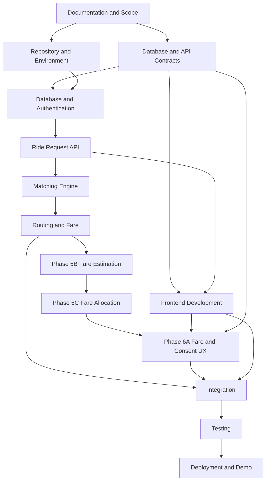

# Smart Share — Project Roadmap and Milestone Plan

**Document:** Project Roadmap & Milestone Plan  
**Version:** 1.0  
**Status:** Proposed  
**Project:** Smart Share

---

## 1. Purpose

This document defines the implementation sequence, milestones, deliverables, responsibilities and completion criteria for Smart Share.

The roadmap is designed for a two-developer team working within a limited hackathon timeline.

The project must proceed in a controlled sequence: documentation, foundation, backend, matching, frontend, integration, testing and demonstration.

## 2. Development Principles

1. Complete and review core documentation before coding.
2. Freeze the MVP scope before implementation.
3. Agree on database and API contracts before parallel development.
4. Build the backend and frontend in parallel only after interfaces are defined.
5. Integrate early rather than waiting until all modules are complete.
6. Test critical matching rules independently.
7. Maintain a working application throughout development.
8. Prioritize the complete primary user journey over optional features.

## 3. Project Phases

### Phase 0 — Planning and Documentation

**Goal:** Establish a shared understanding of the project.

Tasks:

- Finalize Project Charter.
- Finalize SRS/PRD.
- Review system architecture.
- Finalize database entities.
- Define API contracts.
- Prepare matching-engine specification.
- Prepare roadmap.
- Prepare developer guide.
- Record unresolved decisions.

Deliverables:

- Six approved documentation files.
- Initial ER diagram.
- Initial architecture diagram.
- Matching-engine specification.
- List of confirmed technology choices.

Completion criteria:

- Both developers understand the MVP.
- Core requirements are agreed upon.
- No critical database or API design questions remain unresolved.

### Phase 1 — Repository and Development Foundation

**Goal:** Create the development environment.

Tasks:

- Create repository.
- Create `frontend/`, `backend/`, `database/` and `docs/`.
- Configure Git.
- Initialize React/Vite/TypeScript.
- Initialize FastAPI.
- Configure PostgreSQL/PostGIS.
- Configure environment variables.
- Add linting and formatting.
- Add basic health-check endpoint.
- Configure development database.

Deliverables:

- Running frontend skeleton.
- Running backend skeleton.
- Database connection.
- Health endpoint.
- Initial README.

Completion criteria:

- Both developers can run the project locally.
- Frontend can communicate with backend.
- Database connection succeeds.
- Secrets are excluded from Git.

### Phase 2 — Database and Authentication

**Goal:** Establish persistence and identity.

Tasks:

- Create database models.
- Create initial Alembic migrations.
- Enable PostGIS.
- Configure Supabase Auth.
- Implement token verification.
- Implement profile retrieval.
- Implement profile update.
- Add authorization dependencies.

Deliverables:

- Database schema.
- Migration files.
- Authentication integration.
- Profile endpoints.
- Authentication tests.

Completion criteria:

- Authenticated users can access protected endpoints.
- Invalid tokens are rejected.
- User identity is enforced by the backend.

### Phase 3 — Ride Request Management

**Goal:** Implement the basic ride-request lifecycle.

Tasks:

- Create ride-request schemas.
- Implement create request endpoint.
- Implement list and retrieve endpoints.
- Implement update endpoint.
- Implement cancellation.
- Add coordinate validation.
- Add departure-window validation.
- Add spatial indexes.
- Add integration tests.

Deliverables:

- Ride-request API.
- Database persistence.
- Request validation.
- API tests.

Completion criteria:

- Users can create, view, update and cancel eligible requests.
- Invalid requests are rejected.
- Users cannot modify other users' requests.

### Phase 4 — Matching Engine

**Goal:** Identify compatible passenger requests.

Tasks:

- Implement candidate discovery.
- Implement pickup proximity filtering.
- Implement time-window compatibility.
- Implement eligibility checks.
- Implement capacity checks.
- Implement compatibility scoring.
- Implement initial group construction.
- Add algorithm versioning.
- Prepare synthetic test datasets.

Deliverables:

- Candidate filtering module.
- Compatibility module.
- Scoring module.
- Group-construction module.
- Unit tests.

Completion criteria:

- Compatible requests are identified.
- Incompatible time windows are rejected.
- Capacity constraints are respected.
- Matching decisions are explainable.
- The algorithm is reproducible for fixed inputs.

### Phase 5 — Routing and Fare Calculation

**Goal:** Evaluate real road-route feasibility.

Tasks:

- Select routing provider.
- Implement routing adapter.
- Normalize route responses.
- Calculate road distance and duration.
- Evaluate pickup/drop-off sequences.
- Calculate passenger-specific detours.
- Reject infeasible combinations.
- Implement fare estimation.
- Implement fare allocation.
- Add routing-provider failure handling.
- Add caching where appropriate.

Deliverables:

- Routing integration.
- Route feasibility module.
- Stop-order evaluation.
- Fare calculator.
- Related tests.

Completion criteria:

- Route estimates are based on road-routing data.
- Excessive detours are rejected.
- Fare shares are calculated consistently.
- Provider failures are handled gracefully.

#### Phase 5B — Fare Estimation Models

**Scope:** Implement the versioned tariff calculator over Phase 5A's normalized shared and solo route metrics. This milestone produces pre-trip estimates, tariff/surcharge metadata, rounding, and conservative accuracy provenance. Continuous Linear Integration is the approved default for pre-trip estimates under DEC-004. The estimate must be labeled as an estimate, distinguished from the final physical meter charge, and must not claim to reproduce physical meter pulse behavior. The actual electronic meter pulse quantization remains legally unresolved and configurable.

**Boundary:** Phase 5B may calculate solo baselines internally for downstream allocation, but its public response must not expose a co-passenger's contribution, solo baseline fare, savings, or private solo-route information. Cost-share allocation and disclosure are Phase 5C.

**Completion evidence:** tariff boundary/timezone tests pass; route-source accuracy is propagated without overclaiming; estimates use Decimal and conserve wire precision; timeout/fallback behavior is explicit; UI/API copy identifies pre-trip estimates and excluded charges; existing Phase 5A routing/matching behavior remains unchanged. No migration unless separately justified and approved.

#### Phase 5C — Fare Allocation and Passenger Savings

**Scope:** Consume Phase 5B's shared fare and participant solo baseline estimates to compute proportional contributions, savings, negative-savings status, and passenger-specific response data. DEC-008 defines the allocation mathematics. DEC-013 is approved (2026-11-08) for exact contribution disclosure only with bilateral affirmative consent, auditability, and residual inference-risk notice. Co-passenger solo baseline and private savings remain redacted.

**Dependency:** Contract design and pure mathematical test cases may be prepared in parallel. This implementation consumes the stable Phase 5B fare output contract. Hosted integration/deployment acceptance remains contingent on Phase 5B's outstanding hosted E2E evidence and consent-table migration.

**Completion evidence:** paise conservation, fairness bounds, monotonicity, break-even/dissavings, accuracy provenance, viewer-specific authorization, private-field redaction, and consent/decline/withdrawal tests pass. Exact values are returned only when both participants have separately and affirmatively consented. If exact disclosure is rejected, a bucketed policy must be evaluated against algebraic reconstruction through all related totals and shares.

#### Phase 6A — Fare Estimate, Allocation and Consent UX

**Scope:** Extend the existing frontend to present the Phase 5B estimate and, after Phase 5C/API readiness, the approved cost allocation and consent flows. Phase 5C may include minimal consent controls required to safely expose its API; Phase 6A owns the broader integrated fare and consent UX. Explain estimate accuracy and excluded charges, disclose inference risk before opt-in, and provide consent/decline/withdrawal. This does not introduce payment collection.

**Completion evidence:** authenticated API-backed journey, estimate-versus-final-charge labeling, accessible consent explanation, bilateral opt-in before exact disclosure, decline/withdrawal behavior, redaction of private solo economics/routes, loading/error/empty states, and frontend tests against real response contracts.

These lettered milestones clarify the broader Phase 5 and Phase 6 definitions in this roadmap. The Phase 5A routing architecture already identifies Phase 5C as fare allocation; Phase 6A is newly made explicit here because no prior repository document defined it.

### Phase 6 — Frontend Product Development

**Goal:** Build the user-facing application.

Tasks:

- Establish design system.
- Build application layout.
- Implement authentication screens.
- Implement home screen.
- Implement location selection.
- Implement ride request form.
- Implement request status display.
- Implement match results.
- Implement match details.
- Implement group details.
- Integrate map visualization.
- Add loading, empty and error states.

Deliverables:

- Functional frontend.
- Reusable components.
- API integration.
- Responsive layouts.

Completion criteria:

- A user can complete the primary workflow through the UI.
- UI data comes from backend responses.
- Errors and loading states are handled.
- The interface clearly distinguishes a match proposal from a real cab booking.

### Phase 7 — Group Lifecycle and Integration

**Goal:** Connect all major features into a reliable workflow.

Tasks:

- Implement match acceptance.
- Implement match rejection.
- Implement proposal expiry.
- Implement membership updates.
- Implement group confirmation.
- Implement group cancellation.
- Implement transaction-safe seat allocation.
- Integrate frontend acceptance and cancellation flows.
- Add status refresh or in-app notifications.

Deliverables:

- Complete request-to-group workflow.
- Group lifecycle endpoints.
- Integrated frontend.
- Transaction and lifecycle tests.

Completion criteria:

- Users can respond to match proposals.
- Group capacity is never exceeded.
- Duplicate operations are handled safely.
- Invalid state transitions are rejected.

### Phase 8 — Testing and Stabilization

**Goal:** Verify correctness and prepare the demo.

Tasks:

- Run backend unit tests.
- Run backend integration tests.
- Run frontend tests.
- Run E2E tests.
- Test concurrent acceptance.
- Test routing failure.
- Test cancellations.
- Test edge cases.
- Review authorization.
- Review privacy.
- Fix critical defects.

Deliverables:

- Test report.
- Fixed critical defects.
- Reproducible demo dataset.
- Stable release candidate.

Completion criteria:

- All critical workflow tests pass.
- No known critical authorization or data-integrity defect remains.
- The demo can be reset and repeated.

### Phase 9 — Deployment and Demonstration

**Goal:** Deliver a reliable hackathon presentation.

Tasks:

- Deploy frontend.
- Deploy backend.
- Configure production environment variables.
- Configure CORS and HTTPS.
- Apply database migrations.
- Load synthetic demo data.
- Verify health checks.
- Test the deployed workflow.
- Prepare demo script.
- Prepare screenshots and backup recording if needed.

Deliverables:

- Deployed prototype.
- Demo dataset.
- Final presentation.
- Demo walkthrough.

Completion criteria:

- Deployed application works.
- Demo workflow can be repeated.
- All estimates are clearly labelled.
- No unsupported claims are made about real cab dispatch or actual savings.

---

## 4. Suggested 14-Day Execution Schedule

This is an initial schedule. Adjust it to the actual hackathon deadline and team availability.

| Day | Primary Focus | Key Deliverable |
|---|---|---|
| 1 | Documentation review and scope freeze | Approved core documents |
| 2 | Repository, frontend/backend setup | Running skeleton |
| 3 | Database and authentication | Migrations and auth |
| 4 | Ride request APIs | Request lifecycle |
| 5 | Candidate discovery | Geographic and time filtering |
| 6 | Matching algorithm | Feasible candidate groups |
| 7 | Routing integration | Road-route estimates |
| 8 | Detour and fare calculation | Route and fare module |
| 9 | Frontend foundation | Main screens |
| 10 | Ride creation and match UI | Core frontend flow |
| 11 | Group acceptance and lifecycle | Integrated workflow |
| 12 | Testing and concurrency | Critical tests |
| 13 | Deployment and bug fixes | Stable deployed build |
| 14 | Demo preparation | Final presentation and rehearsal |

If the actual available duration differs, preserve the phase order and adjust the time allocation.

## 5. Developer Responsibilities

### Developer A — Frontend

| Phase | Responsibilities |
|---|---|
| Foundation | React setup, routing, UI dependencies |
| Frontend | Design system and screens |
| Integration | API client and authentication |
| Maps | Location selection and route visualization |
| Group Flow | Match response and group status |
| Testing | Component and E2E tests |

### Developer B — Backend

| Phase | Responsibilities |
|---|---|
| Foundation | FastAPI and database setup |
| Database | Models and migrations |
| Authentication | Token verification |
| Ride Requests | Request lifecycle APIs |
| Matching | Candidate filtering and scoring |
| Routing | Route evaluation |
| Fare | Cost allocation |
| Group Flow | Transaction-safe acceptance |
| Testing | Unit and integration tests |

### Shared Work

- Architecture reviews.
- API contract decisions.
- Integration.
- Code reviews.
- Bug triage.
- Demo preparation.

## 6. Dependencies Between Workstreams

Frontend visual development can begin once the API and data contracts are stable. The frontend should use mocked data only temporarily, with a clear plan to replace it with real API integration.

## 7. Milestone Tracking

Track each milestone using:

- `NOT_STARTED`
- `IN_PROGRESS`
- `BLOCKED`
- `IN_REVIEW`
- `COMPLETED`

A milestone is complete only when its acceptance criteria are satisfied.

Suggested tracking table:

| Milestone | Owner | Status | Completion Evidence |
|---|---|---|---|
| Documentation approval | Both | COMPLETED | Reviewed and approved Phase 0 documents |
| Repository setup | Both | COMPLETED | Running local development environment & CI config |
| Database foundation & Auth | Backend | COMPLETED | Hosted Supabase PostgreSQL 17.11, PostGIS, Alembic migration 5b69062ab3ef, ES256 JWKS auth |
| Ride request API & Management | Both | COMPLETED | End-to-end ride request lifecycle, REST endpoints, PostGIS 4326 persistence, React UI |
| Matching engine | Backend | Not started | Matching test report |
| Phase 5B Fare Estimation | Backend | Implemented; hosted E2E acceptance pending | Tariff, provenance, estimate disclaimer and regression evidence; hosted authenticated workflow remains unverified |
<<<<<<< Updated upstream
| Phase 5C Fare Allocation | Backend | Implemented; hosted acceptance pending | DEC-008 allocation/conservation, economic warning, DEC-013 consent enforcement and privacy tests; hosted migration/E2E remain outstanding |
| Phase 6A Fare and Consent UX | Frontend | Not started | Broader authenticated fare presentation after Phase 5C API acceptance; no duplicate allocation logic |
=======
<<<<<<< HEAD
| Phase 5C Fare Allocation | Backend | Implemented; hosted acceptance pending | DEC-008 allocation/conservation, economic warning, DEC-013 consent enforcement and privacy tests; hosted migration/E2E remain outstanding |
| Phase 6A Fare and Consent UX | Frontend | Not started | Broader authenticated fare presentation after Phase 5C API acceptance; no duplicate allocation logic |
=======
| Phase 5C Fare Allocation | Backend | Implemented (Local Verified) | DEC-008 proportional allocation, DEC-013 privacy, 12 invariants tested, reports complete |
| Phase 6A Fare and Consent UX | Frontend | Not started | Authenticated API-backed fare display, bilateral consent flow and UI verification |
>>>>>>> 3dfc1f3 (5C)
>>>>>>> Stashed changes
| Frontend MVP | Frontend | In progress | Core screens (Auth, Profile, Ride Requests complete; Matching next) |
| Integration | Both | In progress | Supabase Auth, Profile, and Ride Requests integrated live |
| Deployment | Both | Not started | Live demo |

## 8. Risk Management

| Risk | Impact | Response |
|---|---|---|
| Documentation delays | High | Prioritize MVP decisions |
| Routing API complexity | High | Validate provider early |
| Matching edge cases | High | Build test dataset early |
| Integration conflicts | Medium | Agree on contracts first |
| Scope creep | High | Move optional features to future scope |
| Deployment issues | High | Deploy a basic version before final days |
| Team dependency bottlenecks | Medium | Keep tasks independently testable |

## 9. Scope Prioritization

### Must Have

- Authentication.
- Ride request creation.
- Geographic and time filtering.
- Route-aware matching.
- Capacity validation.
- Match proposal.
- Accept/decline.
- Group status.
- Fare estimate.
- Basic map visualization.
- Synthetic demo data.

### Should Have

- In-app notifications.
- Event association.
- Request history.
- Improved route visualization.
- Better match explanations.

### Could Have

- Group chat.
- Recurring commute preferences.
- Profile verification.
- Advanced optimization.
- External cab integrations.

### Won't Have in Initial MVP

- Live driver tracking.
- Actual cab dispatch.
- Payment processing.
- Driver application.
- Guaranteed vehicle availability.

## 10. Definition of Done

A feature is complete only when:

1. Its requirements are understood.
2. Its implementation is complete.
3. Relevant tests pass.
4. Errors are handled.
5. Authorization is checked.
6. Documentation is updated.
7. Code is reviewed.
8. It works with the integrated application.

## 11. Final Project Success Metrics

The team will evaluate the prototype using the following initial targets:

- At least 100 synthetic or pilot requests evaluated.
- At least 30% of eligible requests matched into feasible groups.
- At least 20% estimated cost savings for matched passengers.
- Additional journey time no more than 10 minutes where feasible.

These targets must be calculated from a documented dataset and method. They must not be reported as achieved unless supported by actual test results.

---

**Document Status:** Proposed Roadmap. Update dates, owners and status as the hackathon schedule is confirmed.
