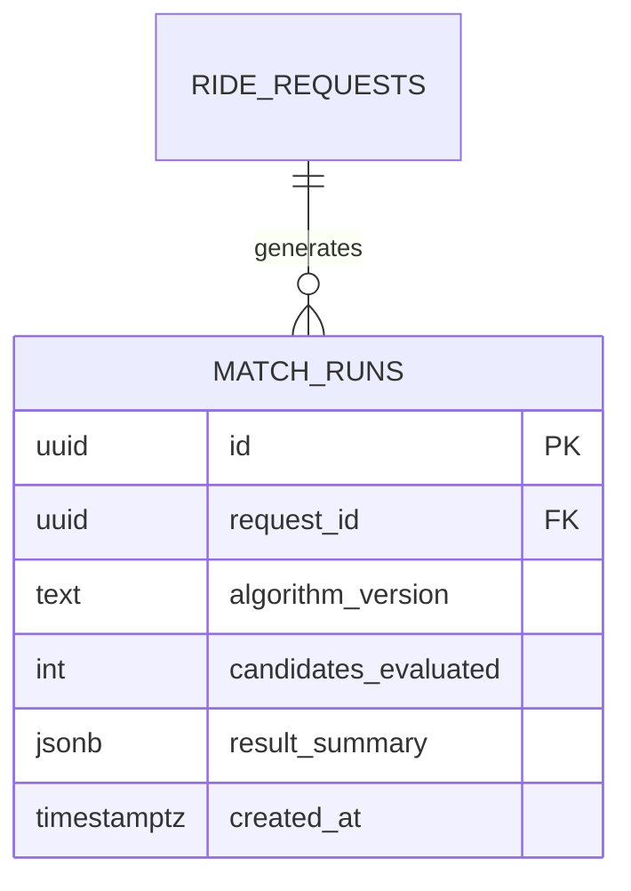

# Smart Share — Phase 4A: Matching Engine Design & Technical Specification

**Document Version:** 1.0.0  
**Phase:** 4A — Matching Engine Design & Technical Specification  
**Status:** COMPLETE / PENDING APPROVAL  
**Author:** Smart Share Engineering Team  
**Date:** November 2026  
**Target Environment:** FastAPI (Python 3.14), SQLAlchemy 2 (Async), PostgreSQL 15+ with PostGIS, Supabase Auth  

---

## Table of Contents

1. [Executive Summary & Purpose](#1-executive-summary--purpose)
2. [Audit of Existing System & Discrepancy Reconciliation](#2-audit-of-existing-system--discrepancy-reconciliation)
   - [2.1 Documentation vs. Implementation Baseline](#21-documentation-vs-implementation-baseline)
   - [2.2 Database Models & Spatial Types](#22-database-models--spatial-types)
   - [2.3 Existing Constraints & Spatial Indexes](#23-existing-constraints--spatial-indexes)
   - [2.4 Authentication & Authorization Guarantees](#24-authentication--authorization-guarantees)
   - [2.5 Frontend Integration Status](#25-frontend-integration-status)
3. [The Ride-Matching Problem in Urban Geography](#3-the-ride-matching-problem-in-urban-geography)
   - [3.1 The Geometry of Mumbai Commuting](#31-the-geometry-of-mumbai-commuting)
   - [3.2 The Straight-Line Fallacy](#32-the-straight-line-fallacy)
   - [3.3 Definition of Practical Ride Feasibility](#33-definition-of-practical-ride-feasibility)
4. [Matching Engine Architectural Pipeline](#4-matching-engine-architectural-pipeline)
   - [4.1 Multi-Stage Filtering Architecture](#41-multi-stage-filtering-architecture)
   - [4.2 End-to-End Matching Algorithm Flow Diagram](#42-end-to-end-matching-algorithm-flow-diagram)
5. [Candidate Discovery Specification (Stage 1)](#5-candidate-discovery-specification-stage-1)
   - [5.1 PostGIS Spatial Query Formulation](#51-postgis-spatial-query-formulation)
   - [5.2 Index Optimization & Query Plan Strategy](#52-index-optimization--query-plan-strategy)
   - [5.3 Temporal Overlap Verification](#53-temporal-overlap-verification)
   - [5.4 Lifecycle State & Expiry Filtering](#54-lifecycle-state--expiry-filtering)
   - [5.5 Seat Capacity Gating](#55-seat-capacity-gating)
   - [5.6 Directional Corridor & Azimuth Gating](#56-directional-corridor--azimuth-gating)
6. [Route Compatibility & Detour Evaluation (Stage 2)](#6-route-compatibility--detour-evaluation-stage-2)
   - [6.1 Comparison of Routing Approaches](#61-comparison-of-routing-approaches)
   - [6.2 Evaluation for Hackathon Scope & Laptop Resources](#62-evaluation-for-hackathon-scope--laptop-resources)
   - [6.3 Hybrid Routing Architecture & Provider Abstraction](#63-hybrid-routing-architecture--provider-abstraction)
   - [6.4 Provider Failure & Graceful Degradation Strategy](#64-provider-failure--graceful-degradation-strategy)
7. [Mathematical Compatibility Scoring Model (Stage 3)](#7-mathematical-compatibility-scoring-model-stage-3)
   - [7.1 Model Overview & Objective Function](#71-model-overview--objective-function)
   - [7.2 Factor Formulations & Normalization](#72-factor-formulations--normalization)
   - [7.3 Hard Gating Rules vs. Soft Scoring Weights](#73-hard-gating-rules-vs-soft-scoring-weights)
   - [7.4 Weight Justification Matrix](#74-weight-justification-matrix)
   - [7.5 Worked Matching Examples](#75-worked-matching-examples)
     - [Worked Example 1: Excellent Match (BKC → Powai Hiranandani)](#worked-example-1-excellent-match-bkc--powai-hiranandani)
     - [Worked Example 2: Borderline Match (BKC → Lower Parel)](#worked-example-2-borderline-match-bkc--lower-parel)
     - [Worked Example 3: Incompatible Match (Anti-Parallel / Backtracking)](#worked-example-3-incompatible-match-anti-parallel--backtracking)
8. [Matching Engine Behavioral Rules & Concurrency](#8-matching-engine-behavioral-rules--concurrency)
   - [8.1 Pairwise MVP vs. Multi-Passenger Extension](#81-pairwise-mvp-vs-multi-passenger-extension)
   - [8.2 Candidate Ranking & Tie-Breaking Hierarchy](#82-candidate-ranking--tie-breaking-hierarchy)
   - [8.3 Deduplication & Canonical Representation](#83-deduplication--canonical-representation)
   - [8.4 Stale & Expired Request Lifecycle](#84-stale--expired-request-lifecycle)
   - [8.5 Multi-Candidate Participation vs. Group Mutex](#85-multi-candidate-participation-vs-group-mutex)
   - [8.6 Concurrency, Race Conditions & Cache Invalidation](#86-concurrency-race-conditions--cache-invalidation)
9. [API & Architecture Contract Specification](#9-api--architecture-contract-specification)
   - [9.1 Endpoint Specifications](#91-endpoint-specifications)
   - [9.2 Pydantic Schemas & DTO Definitions](#92-pydantic-schemas--dto-definitions)
   - [9.3 Synchronous vs. Asynchronous Execution Model](#93-synchronous-vs-asynchronous-execution-model)
   - [9.4 Security, Ownership & Error Codes](#94-security-ownership--error-codes)
10. [Database Impact Assessment](#10-database-impact-assessment)
    - [10.1 Schema Reuse & Table Analysis](#101-schema-reuse--table-analysis)
    - [10.2 Proposed Schema Additions for Match Persistence](#102-proposed-schema-additions-for-match-persistence)
    - [10.3 Non-Destructive Migration Plan](#103-non-destructive-migration-plan)
11. [Comprehensive Testing Strategy](#11-comprehensive-testing-strategy)
    - [11.1 Test Pyramid & Verification Dimensions](#111-test-pyramid--verification-dimensions)
    - [11.2 Realistic Mumbai Test Dataset Matrix](#112-realistic-mumbai-test-dataset-matrix)
    - [11.3 Boundary, Concurrency & Failure Test Cases](#113-boundary-concurrency--failure-test-cases)
12. [Risks, Assumptions & Unresolved Decisions](#12-risks-assumptions--unresolved-decisions)
13. [Verdict & Phase Recommendation](#13-verdict--phase-recommendation)

---

## 1. Executive Summary & Purpose

Phase 3 (Ride Request Management) has concluded with a **PASS** verdict. The Smart Share platform reliably persists user profiles, enforces authentication via Supabase JWTs, validates spatial and temporal boundaries, and manages the complete lifecycle of passenger ride requests (`ACTIVE`, `MATCHED`, `CANCELLED`, `EXPIRED`, `COMPLETED`).

This document constitutes the **Phase 4A Technical Specification and System Design** for the intelligent ride-matching engine. The objective is to design a high-performance, explainable, and geographically realistic matching algorithm tailored to urban transportation bottlenecks (specifically Mumbai), without prematurely implementing algorithmic code or destructively altering the database schema.

Implementation will proceed strictly in Phase 4B after explicit review and approval of this specification.

---

## 2. Audit of Existing System & Discrepancy Reconciliation

### 2.1 Documentation vs. Implementation Baseline

A rigorous audit of the Phase 0 architecture documents (`docs/01` through `docs/05`) against the codebase implementation reveals key alignments and intentional scope deferrals:

| Architectural Component | Phase 0 Documentation (`docs/04`) | Implemented Baseline (`backend/` & `alembic/`) | Status & Reconciliation |
| :--- | :--- | :--- | :--- |
| **`profiles` Table** | UUID PK referencing `auth.users.id`, `display_name`, timestamps | Present in Migration `5b69062ab3ef`, models in [`profile.py`](file:///home/asta/Projects/Smart_Share/backend/app/models/profile.py) | **Identical** |
| **`ride_requests` Table** | Points, labels, departure times, seats, max extra min, status | Present in Migration `5b69062ab3ef`, models in [`ride_request.py`](file:///home/asta/Projects/Smart_Share/backend/app/models/ride_request.py) | **Identical** |
| **`event_id` in `ride_requests`** | Optional FK to `events.id` | Column omitted in migration `5b69062ab3ef` | **Reconciled Discrepancy:** MVP prioritizes point-to-point pooling; event pooling is deferred to future phase per Project Charter Section 4. |
| **`events` Table** | Optional event zones | Omitted | Deferred to post-MVP. |
| **`match_runs` Table** | Logging matching runs | Omitted in initial migration | **Addressed in Phase 4A:** Matching engine discovery is designed to operate on-demand; optional non-destructive audit table specified in Section 10. |
| **`ride_groups` / `ride_stops`** | Group lifecycle & ordered stops | Not yet created | Phase 5 / Phase 7 scope. |
| **Pagination Style** | Documentation mentions `cursor` | Implemented as `limit` and `offset` | Implemented offset-limit pagination is compliant with standard frontend data tables. |

### 2.2 Database Models & Spatial Types

- **Coordinate System:** WGS 84 (`EPSG:4326`) stored as PostGIS `geography(Point, 4326)`.
- **Coordinate Storage Ordering:** PostGIS strictly follows $(X, Y) \equiv (\text{Longitude}, \text{Latitude})$ for WKT representations (`POINT(longitude latitude)`).
- **Application Level Ordering:** Pydantic schemas, TypeScript interfaces, and REST API payloads consume `latitude` and `longitude`. The [`app.core.spatial`](file:///home/asta/Projects/Smart_Share/backend/app/core/spatial.py) module handles conversion via `to_geography_point(lat, lon)` and `parse_point_coordinates(geom)`.

### 2.3 Existing Constraints & Spatial Indexes

The production schema already incorporates necessary database-level invariants:
1. `chk_ride_requests_departure_window`: `departure_latest >= departure_earliest`
2. `chk_ride_requests_seats`: `seats_requested >= 1 AND seats_requested <= 6`
3. `chk_ride_requests_max_extra_minutes`: `max_extra_minutes >= 0 AND max_extra_minutes <= 180`
4. `chk_ride_requests_status`: `status IN ('ACTIVE', 'MATCHED', 'CANCELLED', 'EXPIRED', 'COMPLETED')`
5. `chk_ride_requests_distinct_endpoints`: `NOT ST_Equals(pickup_location::geometry, destination::geometry)`
6. `chk_ride_requests_expiry_window`: `expires_at IS NULL OR expires_at <= departure_latest`

**Existing Indexes Available for Matching:**
- `idx_ride_requests_pickup_gist`: GiST spatial index on `pickup_location`.
- `idx_ride_requests_destination_gist`: GiST spatial index on `destination`.
- `idx_ride_requests_active_departure`: Partial composite B-tree index on `(status, departure_earliest, departure_latest)` `WHERE status = 'ACTIVE'`.
- `idx_ride_requests_active_expiry`: Partial index on `expires_at` `WHERE status = 'ACTIVE' AND expires_at IS NOT NULL`.

### 2.4 Authentication & Authorization Guarantees

All endpoints are protected by Supabase JWT verification (`app.api.dependencies.get_current_user`). Request modifications and retrieval strictly verify ownership (`entity.user_id == current_user.id`). The matching engine must respect these privacy boundaries: candidate results presented to a user must expose only necessary journey coordination details, never private contact data or third-party user identifiers.

### 2.5 Frontend Integration Status

The frontend is a Vite + React + TypeScript single-page application. Preset locations in [`frontend/src/features/ride-requests/presets.ts`](file:///home/asta/Projects/Smart_Share/frontend/src/features/ride-requests/presets.ts) capture real-world Mumbai landmarks:
- Bandra Kurla Complex (BKC): `(19.0657, 72.8687)`
- Mumbai Airport T2 (CSMIA): `(19.0886, 72.8679)`
- CSMT / Colaba: `(18.9402, 72.8356)`
- Powai (IIT Bombay / Hiranandani): `(19.1176, 72.9060)`
- Lower Parel (One World Center): `(19.0016, 72.8311)`
- Dadar Station: `(19.0178, 72.8478)`
- Andheri West: `(19.1412, 72.8315)`

---

## 3. The Ride-Matching Problem in Urban Geography

### 3.1 The Geometry of Mumbai Commuting

Mumbai's physical geography is a narrow peninsula bounded by the Arabian Sea to the west and Thane Creek / Mumbai Harbour to the east. Traffic flow is dominated by constrained north-south arterial corridors:
1. **Western Corridor:** Western Express Highway (WEH), SV Road, Linking Road.
2. **Eastern Corridor:** Eastern Express Highway (EEH), Eastern Freeway.
3. **Cross-Subbourn Connectors:** Santacruz-Chembur Link Road (SCLR), Jogeshwari-Vikhroli Link Road (JVLR), Goregaon-Mulund Link Road (GMLR).
4. **Sea Crossings:** Bandra-Worli Sea Link (BWSL), Atal Setu (MTHL).

Because of this linear topography and natural water barriers, geographic straight-line distance is fundamentally detached from actual road travel time.

### 3.2 The Straight-Line Fallacy

Matching algorithms that evaluate compatibility solely using straight-line Euclidean or Haversine distance suffer from severe structural failures:

1. **The Water Barrier Problem:**
   - A passenger at Bandra Bandstand and a passenger at Worli Sea Face are separated by only $3.5\text{ km}$ straight-line across Mahim Bay.
   - However, without crossing the Sea Link (toll road) or traversing the Mahim Causeway bottle-neck, driving distance is $>10\text{ km}$ and travel time can exceed 35 minutes in traffic.
2. **The Anti-Parallel Heading Problem:**
   - Two passengers are waiting at Dadar Central Station (pickups are literally $0\text{ meters}$ apart).
   - Passenger A is heading south to Colaba (Azimuth $\approx 188^\circ$).
   - Passenger B is heading north to Borivali (Azimuth $\approx 2^\circ$).
   - A naive proximity algorithm would score them a 100% pickup match. In reality, sharing a vehicle requires one passenger to endure a 100% backward detour.
3. **The Highway Entry Bottleneck:**
   - Two pickup points might be $400\text{ meters}$ apart on opposite sides of the Western Express Highway, separated by concrete medians. A car picking up both passengers might require a $3\text{ km}$ U-turn detour taking 15 minutes.

### 3.3 Definition of Practical Ride Feasibility

A proposed match between Request $A$ (the primary requester) and Candidate $B$ is **practically feasible** if and only if all five invariant criteria are satisfied:

$$\text{Feasible}(A, B) \iff C_{\text{spatial}} \land C_{\text{direction}} \land C_{\text{temporal}} \land C_{\text{capacity}} \land C_{\text{detour}}$$

1. **Origin Proximity ($C_{\text{spatial}}$):**  
   The road network pickup distance between $A$ and $B$ must not exceed a configured urban threshold $D_{\text{pickup, max}}$ (default: $2,000\text{ meters}$).
2. **Directional Compatibility ($C_{\text{direction}}$):**  
   The transit vectors $\vec{V}_A = \vec{D}_A - \vec{P}_A$ and $\vec{V}_B = \vec{D}_B - \vec{P}_B$ must travel in the same general corridor. The angular divergence between their travel azimuths must not exceed $\theta_{\text{max}}$ (default: $45^\circ$, or vector cosine similarity $\ge 0.707$).
3. **Temporal Departure Overlap ($C_{\text{temporal}}$):**  
   The departure intervals $[E_A, L_A]$ and $[E_B, L_B]$ must intersect:
   $$\max(E_A, E_B) \le \min(L_A, L_B)$$
4. **Capacity Sufficiency ($C_{\text{capacity}}$):**  
   The sum of requested seats must not exceed the vehicle capacity:
   $$S_A + S_B \le C_{\text{vehicle}} \quad (C_{\text{vehicle}} = 4\text{ standard})$$
5. **Individual Detour Tolerances ($C_{\text{detour}}$):**  
   For every passenger $i \in \{A, B\}$, the additional travel time in the shared route sequence compared to their direct individual journey must not exceed their specified `max_extra_minutes`:
   $$\Delta T_i = T_{\text{shared}, i} - T_{\text{direct}, i} \le \text{max\_extra\_minutes}_i$$

---

## 4. Matching Engine Architectural Pipeline

### 4.1 Multi-Stage Filtering Architecture

To achieve sub-second response times while preventing external routing API rate exhaustion, the matching engine employs a **funnel pipeline**:

```text
[ Entire Database of Ride Requests ]
                │
                ▼ (Stage 1: PostGIS Spatio-Temporal Candidate Pruning)
[ Promising Candidates (N <= 20) ]  -- Filtered via GiST & Partial Indexes (0 API calls)
                │
                ▼ (Stage 2: Directional Corridor & Vector Gating)
[ Directionally Compatible Candidates (N <= 8) ] -- Filtered via Azimuth & Geodesic Heading
                │
                ▼ (Stage 3: Route Sequence & Detour Evaluation)
[ Feasible Route Pairings (N <= 5) ] -- Road network or calibrated tortuosity matrix
                │
                ▼ (Stage 4: Compatibility Scoring & Proposal Ranking)
[ Ranked Match Proposals with Explainable Metadata ]
```

### 4.2 End-to-End Matching Algorithm Flow Diagram

```mermaid
flowchart TD
    Start([User Initiates Match Discovery for Request A]) --> AuthCheck{Is User Authenticated & Owner?}
    AuthCheck -- No --> Err403[Return 403 Forbidden / 401 Unauthorized]
    AuthCheck -- Yes --> LoadA[Fetch Request A from Database]
    
    LoadA --> StateCheck{Is Request A Status == ACTIVE?}
    StateCheck -- No --> Err400[Return 400 REQUEST_NOT_ACTIVE]
    StateCheck -- Yes --> ExpCheck{Has Request A Expired?}
    ExpCheck -- Yes --> MarkExp[Transition A to EXPIRED & Return 400]
    
    ExpCheck -- No --> Stage1[Stage 1: PostGIS Candidate Discovery Query]
    subgraph Stage1_PostGIS [Stage 1: PostGIS Index-Driven Query]
        S1_1[Filter status == ACTIVE]
        S1_2[Filter user_id != A.user_id AND id != A.id]
        S1_3[Filter expires_at > NOW]
        S1_4[Filter ST_DWithin pickup_location, A.pickup, 2000m]
        S1_5[Filter departure window overlap: B.start <= A.end AND B.end >= A.start]
        S1_6[Filter B.seats + A.seats <= 4]
        S1_1 --> S1_2 --> S1_3 --> S1_4 --> S1_5 --> S1_6
    end
    
    Stage1 --> CandCount{Candidates Found > 0?}
    CandCount -- No --> EmptyResp[Return 200 with Empty Candidate List]
    CandCount -- Yes --> Stage2[Stage 2: Directional & Corridor Filtering]
    
    subgraph Stage2_Direction [Stage 2: Corridor Analysis]
        S2_1[Calculate Azimuth Vector A: P_A -> D_A]
        S2_2[Calculate Azimuth Vector B: P_B -> D_B]
        S2_3[Compute Angular Delta: |Az_A - Az_B| mod 360]
        S2_4{Angular Delta <= 45 deg OR Dest Proximity <= 3km?}
        S2_1 --> S2_2 --> S2_3 --> S2_4
    end
    
    Stage2 --> S2_4
    S2_4 -- Incompatible Corridor --> PruneCand[Discard Candidate B]
    S2_4 -- Compatible Corridor --> Stage3[Stage 3: Route Permutation & Detour Check]
    
    subgraph Stage3_Routing [Stage 3: Sequence Evaluation]
        S3_1[Generate Valid Permutations: P_A->P_B->D_B->D_A or P_A->P_B->D_A->D_B]
        S3_2[Evaluate Road Distance & Travel Times via Routing Service]
        S3_3[Compute Passenger Detours: Delta_T_A and Delta_T_B]
        S3_4{Delta_T_A <= MaxExtra_A AND Delta_T_B <= MaxExtra_B?}
        S3_1 --> S3_2 --> S3_3 --> S3_4
    end
    
    Stage3 --> S3_4
    S3_4 -- Detour Exceeded --> PruneCand
    S3_4 -- Detour Acceptable --> Stage4[Stage 4: Multi-Factor Scoring & Ranking]
    
    subgraph Stage4_Scoring [Stage 4: Scoring Engine]
        S4_1[Compute Pickup Proximity Score S_pickup]
        S4_2[Compute Destination Similarity Score S_dest]
        S4_3[Compute Temporal Overlap Score S_time]
        S4_4[Compute Detour Efficiency Score S_detour]
        S4_5[Compute Capacity Utilization Score S_capacity]
        S4_6[Composite Score = 0.25*P + 0.25*D + 0.20*T + 0.20*R + 0.10*C]
        S4_1 --> S4_2 --> S4_3 --> S4_4 --> S4_5 --> S4_6
    end
    
    Stage4 --> S4_6
    S4_6 --> Rank[Sort Proposals by Composite Score DESC]
    Rank --> LimitK[Select Top K Proposals default=5]
    LimitK --> ReturnJSON[Return 200 OK with Formatted Match Proposals]
```

---

## 5. Candidate Discovery Specification (Stage 1)

### 5.1 PostGIS Spatial Query Formulation

Candidate discovery is executed directly within PostgreSQL using PostGIS spatial functions, taking full advantage of GiST indexes on geography points.

Given target ride request $A$:

```sql
SELECT 
    b.id,
    b.user_id,
    p.display_name AS owner_name,
    p.avatar_url AS owner_avatar,
    b.pickup_location,
    b.destination,
    b.pickup_label,
    b.destination_label,
    b.departure_earliest,
    b.departure_latest,
    b.seats_requested,
    b.max_extra_minutes,
    b.status,
    -- Exact geodesic distance between pickups in meters
    ST_Distance(b.pickup_location, :a_pickup_geog) AS pickup_distance_meters,
    -- Exact geodesic distance between destinations in meters
    ST_Distance(b.destination, :a_dest_geog) AS destination_distance_meters,
    -- Temporal overlap interval in seconds
    EXTRACT(EPOCH FROM (
        LEAST(b.departure_latest, :a_departure_latest) - 
        GREATEST(b.departure_earliest, :a_departure_earliest)
    )) AS overlap_seconds,
    -- Azimuth calculation in degrees [0, 360) for directional compatibility
    ABS(
        DEGREES(ST_Azimuth(b.pickup_location::geometry, b.destination::geometry)) -
        DEGREES(ST_Azimuth(:a_pickup_geog::geometry, :a_dest_geog::geometry))
    ) AS raw_azimuth_delta
FROM ride_requests b
JOIN profiles p ON b.user_id = p.id
WHERE 
    -- 1. Status & Lifecycle Gating
    b.status = 'ACTIVE'
    -- 2. Non-self & Non-identical User
    AND b.id != :a_id
    AND b.user_id != :a_user_id
    -- 3. Temporal Expiry Boundary
    AND COALESCE(b.expires_at, b.departure_latest) > NOW()
    -- 4. Capacity Gating (combined seats must fit vehicle capacity)
    AND (b.seats_requested + :a_seats_requested) <= :max_vehicle_capacity
    -- 5. Departure Window Intersection
    AND b.departure_earliest <= :a_departure_latest
    AND b.departure_latest >= :a_departure_earliest
    -- 6. Spatial Proximity Gating (uses idx_ride_requests_pickup_gist)
    AND ST_DWithin(b.pickup_location, :a_pickup_geog, :max_pickup_radius_meters)
ORDER BY 
    pickup_distance_meters ASC
LIMIT :candidate_fetch_limit;
```

### 5.2 Index Optimization & Query Plan Strategy

To guarantee that the query avoids full-table scans even with $100,000+$ active requests:
1. **Spatial Index Utilization:**  
   `ST_DWithin(b.pickup_location, :a_pickup_geog, :max_pickup_radius_meters)` matches the existing index `idx_ride_requests_pickup_gist`. PostGIS transforms the spherical radius into an indexed bounding box filter (using the geometry bounding box of the spheroid), immediately discarding $>99\%$ of the dataset.
2. **Temporal Index Utilization:**  
   The existing partial index:
   ```sql
   CREATE INDEX idx_ride_requests_active_departure 
   ON ride_requests (status, departure_earliest, departure_latest) 
   WHERE status = 'ACTIVE';
   ```
   allows PostgreSQL to perform an **Index Scan** or a **Bitmap Index Scan**, intersecting the spatial candidate bitmap with the active departure time bitmap.
3. **Execution Plan Guarantee:**  
   The query planner executes a `BitmapAnd` combining `idx_ride_requests_pickup_gist` and `idx_ride_requests_active_departure`. Sequential table scans (`Seq Scan`) are eliminated.

### 5.3 Temporal Overlap Verification

Two requests $A$ and $B$ are temporally compatible if and only if their intervals intersect:

$$O_{\text{seconds}} = \min(L_A, L_B) - \max(E_A, E_B) \ge 0$$

Where:
- $E_i$ is `departure_earliest` of request $i$.
- $L_i$ is `departure_latest` of request $i$.

The common departure window is:

$$W_{\text{shared}} = \left[\max(E_A, E_B), \; \min(L_A, L_B)\right]$$

Any proposed shared departure time $T_{\text{depart}}$ selected by the system will fall inside $W_{\text{shared}}$, guaranteeing that neither passenger is forced to depart before their earliest preference or after their latest tolerance.

### 5.4 Lifecycle State & Expiry Filtering

- **Eligible Status:** Only requests with `status == 'ACTIVE'` are evaluated. Requests in `MATCHED`, `CANCELLED`, `EXPIRED`, or `COMPLETED` are excluded at index level.
- **Active Expiration:** Even if a background cron worker has not yet transitioned a stale request row to `EXPIRED`, the query dynamically enforces:
  $$\text{COALESCE}(\text{expires\_at}, \text{departure\_latest}) > \text{NOW}()$$
  preventing stale records from appearing in real-time match runs.

### 5.5 Seat Capacity Gating

Smart Share models standard ride-sharing passenger vehicles (e.g., sedans, hatchbacks) with an operational capacity $C_{\text{vehicle}} = 4$ seats.
- Any candidate where $S_A + S_B > C_{\text{vehicle}}$ is filtered out during discovery.
- Larger vehicle tiers (e.g., 6-seater SUVs) can be configured via `settings.MAX_VEHICLE_CAPACITY = 6` without altering query semantics.

### 5.6 Directional Corridor & Azimuth Gating

To prevent anti-parallel matches (e.g. Dadar to Colaba vs. Dadar to Borivali), Stage 2 calculates the forward geodesic azimuth $\theta \in [0^\circ, 360^\circ)$ from pickup to destination:

$$\Delta \theta = \min\left(|\theta_A - \theta_B|, \; 360^\circ - |\theta_A - \theta_B|\right)$$

**Gating Rule:**
$$\Delta \theta \le 45^\circ \quad \lor \quad d(D_A, D_B) \le 3,000\text{ meters}$$

If the angular difference exceeds $45^\circ$ AND the destinations are more than $3\text{ km}$ apart, Candidate $B$ is pruned immediately.

---

## 6. Route Compatibility & Detour Evaluation (Stage 2)

### 6.1 Comparison of Routing Approaches

| Approach | Latency | Computational Cost | Accuracy in Mumbai | Suitability for Hackathon MVP |
| :--- | :--- | :--- | :--- | :--- |
| **1. Straight-Line (Haversine/Spheroid)** | $<0.1\text{ ms}$ | Negligible (CPU in-memory) | **Unacceptable:** Ignores water bodies, flyovers, and one-way grids | Prohibited as sole detour determinant |
| **2. Calibrated Heuristic with Tortuosity Factor** | $<0.5\text{ ms}$ | Very Low (In-memory PostGIS/Python) | **Moderate:** Accurately models road curvature ($d_{\text{road}} \approx 1.4 \times d_{\text{geodesic}}$) with azimuth corridor checks | **Recommended as instant fallback / local baseline** |
| **3. Self-Hosted OSRM (Docker)** | $5\text{ - }15\text{ ms}$ | High (Requires 1-2 GB RAM, 500 MB Mumbai OSM extract, pre-processing) | **High:** Exact OSM road-network topology, turn restrictions | Excellent for dedicated servers; heavy for quick laptop hackathon setup |
| **4. External Cloud Routing API (OSRM/ORS/Mapbox)** | $150\text{ - }350\text{ ms}$ | Zero local RAM; depends on network & free API quotas | **High:** Real road distances, turn-by-turn route geometry | **Recommended for Top-K candidate evaluation in Phase 4/5** |

### 6.2 Evaluation for Hackathon Scope & Laptop Resources

For a fast-paced hackathon running on developer laptops:
- **Running a full OSRM container locally** with OpenStreetMap extracts requires downloading `.osm.pbf` files, executing `osrm-extract` and `osrm-contract`, and dedicating 1.5 GB of RAM. This introduces developer environment friction.
- **Calling external APIs for all 50 database rows** exhausts free-tier rate limits and introduces latency spikes (up to 10 seconds per match request).
- **The Optimal Hybrid Strategy:**
  1. Use PostGIS + Corridor Vector Math to prune the database to the **Top 5 candidates**.
  2. Evaluate actual road detour using an asynchronous **`RoutingProvider` adapter** for those top candidates only (total 2 to 4 API calls per match search).
  3. If external network is absent or provider rate limits hit, degrade gracefully to the **Calibrated Tortuosity Model** without breaking the application.

### 6.3 Hybrid Routing Architecture & Provider Abstraction

We define an abstract Python interface in `backend/app/routing/base.py`:

```python
from abc import ABC, abstractmethod
from pydantic import BaseModel

class RouteWaypoint(BaseModel):
    latitude: float
    longitude: float
    stop_type: str  # "PICKUP" or "DROPOFF"
    passenger_request_id: str

class RouteEvaluationResult(BaseModel):
    total_distance_meters: float
    total_duration_seconds: float
    waypoints_order: list[RouteWaypoint]
    route_geometry_geojson: dict | None
    is_approximate: bool = False

class RoutingProvider(ABC):
    @abstractmethod
    async def get_route(
        self, waypoints: list[RouteWaypoint]
    ) -> RouteEvaluationResult:
        """Calculate optimal driving route and sequence duration."""
        pass
```

#### Route Sequence Permutations for 2 Passengers ($A$ and $B$)
Since passenger $A$ initiated the search, pickup $P_A$ is the starting stop. There are two structurally valid visit permutations:
1. **Sequence 1 ($P_A \to P_B \to D_B \to D_A$):** Pick up $A$, pick up $B$, drop off $B$ along the way, then drop off $A$.
2. **Sequence 2 ($P_A \to P_B \to D_A \to D_B$):** Pick up $A$, pick up $B$, drop off $A$ first, then proceed to drop off $B$.

*(Note: Sequences where drop-off precedes pickup are physically impossible and discarded by construction).*

For both permutations, the routing engine calculates:
- $T_{\text{shared}}$: Total duration of the shared journey.
- $T_{\text{direct}, A}$: Duration if $A$ drove directly $P_A \to D_A$.
- $T_{\text{direct}, B}$: Duration if $B$ drove directly $P_B \to D_B$.
- $\Delta T_A = T_{\text{shared}, A} - T_{\text{direct}, A}$: Additional detour time experienced by passenger $A$.
- $\Delta T_B = T_{\text{shared}, B} - T_{\text{direct}, B}$: Additional detour time experienced by passenger $B$.

The permutation that minimizes $(\Delta T_A + \Delta T_B)$ is selected.

### 6.4 Provider Failure & Graceful Degradation Strategy

If the external routing provider is down, times out ($>2.0\text{ seconds}$), or returns an HTTP 429 (Rate Limit):
1. The routing module logs a structured warning (`ROUTING_PROVIDER_FALLBACK`).
2. The engine calculates estimated road distance using the urban tortuosity formula:
   $$D_{\text{road}} = 1.40 \times D_{\text{geodesic}}$$
   and duration assuming an average Mumbai daytime transit speed of $22\text{ km/h}$ ($6.11\text{ m/s}$):
   $$T_{\text{est}} = \frac{D_{\text{road}}}{6.11}$$
3. The response returns proposal metadata with `is_approximate: true` and an informational notice to the frontend: `"Route duration estimated using spatial corridor baseline"`.
4. The system never crashes or halts match discovery due to external service outages.

---

## 7. Mathematical Compatibility Scoring Model (Stage 3)

### 7.1 Model Overview & Objective Function

The compatibility score $S(A, B) \in [0.0, 1.0]$ provides a normalized, transparent, and explainable measure of how mutually beneficial and convenient a shared journey is for both passengers.

The composite score is defined as:

$$S(A, B) = w_P \cdot S_{\text{pickup}} + w_D \cdot S_{\text{dest}} + w_T \cdot S_{\text{time}} + w_R \cdot S_{\text{detour}} + w_C \cdot S_{\text{capacity}}$$

$$\sum_{k} w_k = w_P + w_D + w_T + w_R + w_C = 0.25 + 0.25 + 0.20 + 0.20 + 0.10 = 1.00$$

Every component $S_k \in [0.0, 1.0]$. A score of $1.0$ represents a flawless match, while scores below $0.50$ represent low-compatibility pairings that are ranked low or filtered out.

### 7.2 Factor Formulations & Normalization

#### 1. Pickup Proximity Factor ($S_{\text{pickup}}$)
Measures the walking or quick-cab distance between the two pickup locations.
- **Inputs:** Geodesic distance $d_P = \text{ST\_Distance}(P_A, P_B)$ in meters. Max radius $D_{P, \text{max}} = 2,000\text{ m}$.
- **Formula:**
  $$S_{\text{pickup}} = \max\left(0.0, \; 1.0 - \frac{d_P}{D_{P, \text{max}}}\right)$$
- **Behavior:** Pickups $0\text{ m}$ apart yield $1.0$. Pickups $1,000\text{ m}$ apart yield $0.50$. Pickups at $2,000\text{ m}$ yield $0.0$. Pickups $>2,000\text{ m}$ are hard-gated to $0$.

#### 2. Destination Similarity & Alignment Factor ($S_{\text{dest}}$)
Evaluates whether destinations are close together or aligned along the same travel corridor.
- **Inputs:** Geodesic destination distance $d_D = \text{ST\_Distance}(D_A, D_B)$ in meters. Angular azimuth difference $\Delta \theta \in [0^\circ, 180^\circ]$. Max destination radius $D_{D, \text{max}} = 5,000\text{ m}$.
- **Formula:**
  $$S_{\text{dest, dist}} = \max\left(0.0, \; 1.0 - \frac{d_D}{D_{D, \text{max}}}\right)$$
  $$S_{\text{dest, heading}} = \max\left(0.0, \; \cos(\Delta \theta)\right)$$
  $$S_{\text{dest}} = 0.60 \cdot S_{\text{dest, dist}} + 0.40 \cdot S_{\text{dest, heading}}$$
- **Behavior:** If destinations are identical ($d_D = 0, \Delta \theta = 0$), $S_{\text{dest}} = 1.0$. If destinations are $10\text{ km}$ apart but heading is identical along a major highway corridor ($\Delta \theta \approx 0^\circ$), $S_{\text{dest}} = 0.40$, enabling corridor drop-offs. If headings are perpendicular ($\Delta \theta = 90^\circ$), $S_{\text{dest, heading}} = 0.0$.

#### 3. Departure Time Compatibility Factor ($S_{\text{time}}$)
Measures the temporal convenience of shared departure.
- **Inputs:** Overlap duration $O_{\text{seconds}} = \min(L_A, L_B) - \max(E_A, E_B)$. Window sizes $W_A = L_A - E_A$ and $W_B = L_B - E_B$. Midpoint difference $\Delta T_{\text{mid}} = |T_{\text{mid}, A} - T_{\text{mid}, B}|$ in minutes.
- **Formula:**
  $$S_{\text{time, overlap}} = \min\left(1.0, \; \frac{O_{\text{seconds}}}{\min(W_A, W_B)}\right)$$
  $$S_{\text{time, mid}} = \max\left(0.0, \; 1.0 - \frac{\Delta T_{\text{mid}}}{30.0}\right)$$
  $$S_{\text{time}} = 0.70 \cdot S_{\text{time, overlap}} + 0.30 \cdot S_{\text{time, mid}}$$
- **Behavior:** Identical windows yield $1.0$. Non-overlapping windows are hard-gated out in Stage 1 ($S_{\text{time}} = 0$).

#### 4. Route Deviation & Detour Factor ($S_{\text{detour}}$)
Penalizes added travel time relative to the passengers' stated detour limits.
- **Inputs:** Detours $\Delta T_A$ and $\Delta T_B$ (in minutes). Tolerances $M_A = \text{max\_extra\_minutes}_A$ and $M_B = \text{max\_extra\_minutes}_B$.
- **Formula:**
  $$\rho_A = \frac{\Delta T_A}{\max(1, M_A)}, \quad \rho_B = \frac{\Delta T_B}{\max(1, M_B)}$$
  $$S_{\text{detour}} = \max\left(0.0, \; 1.0 - \frac{\rho_A + \rho_B}{2}\right)$$
- **Behavior:** Zero detour ($\Delta T = 0$) yields $1.0$. If both passengers absorb exactly $50\%$ of their allowed detour, $S_{\text{detour}} = 0.50$. If either passenger exceeds their allowed detour ($\rho_i > 1.0$), the hard gating rule rejects the match immediately.

#### 5. Capacity Utilization Factor ($S_{\text{capacity}}$)
Rewards efficient utilization of vehicle seats.
- **Inputs:** Seats requested $S_A$ and $S_B$. Vehicle capacity $C_{\text{vehicle}} = 4$.
- **Formula:**
  $$S_{\text{capacity}} = \frac{S_A + S_B}{C_{\text{vehicle}}}$$
- **Behavior:** 2 solo passengers ($1 + 1 = 2$ seats) yield $0.50$. 3 seats utilized yield $0.75$. A full cab (4 seats) yields $1.00$.

### 7.3 Hard Gating Rules vs. Soft Scoring Weights

Soft scoring weights cannot rescue a fundamentally infeasible trip. The following **Hard Gating Invariants** force an immediate match rejection ($S_{\text{total}} = 0.0$ and exclusion from results):

1. **Capacity Overfill:** $S_A + S_B > C_{\text{vehicle}}$.
2. **Temporal Disconnection:** $\min(L_A, L_B) < \max(E_A, E_B)$ (Zero overlap).
3. **Detour Violation:** $\Delta T_A > M_A \lor \Delta T_B > M_B$.
4. **Spatial Boundary Exceeded:** $d(P_A, P_B) > D_{P, \text{max}}$.
5. **Anti-Parallel Vector:** $\Delta \theta > 90^\circ$ (Journeys heading in opposing directions).

### 7.4 Weight Justification Matrix

| Factor | Weight | Justification |
| :--- | :--- | :--- |
| **Pickup Proximity ($S_{\text{pickup}}$)** | **0.25** | High priority. Picking up passenger B must not involve a major diversion before the main journey starts. |
| **Destination Compatibility ($S_{\text{dest}}$)** | **0.25** | High priority. Trips must terminate in the same neighborhood or along the direct line of transit. |
| **Departure Time ($S_{\text{time}}$)** | **0.20** | Medium-high priority. Passengers cannot wait indefinitely; shared departure must fall comfortably within both windows. |
| **Route Detour ($S_{\text{detour}}$)** | **0.20** | Medium-high priority. Excessive extra minutes spent in Mumbai traffic is the leading cause of carpooling abandonment. |
| **Capacity Utilization ($S_{\text{capacity}}$)** | **0.10** | Low-medium priority. Useful tie-breaker to favor filling empty seats, but secondary to passenger convenience. |

---

### 7.5 Worked Matching Examples

#### Worked Example 1: Excellent Match (BKC → Powai Hiranandani)

Two tech professionals leaving Bandra Kurla Complex heading toward Powai / IIT Bombay on a weekday evening.

- **Request A (Target):**
  - Pickup: BKC Maker Maxity `(19.0657, 72.8687)`
  - Destination: Powai Hiranandani Gardens `(19.1176, 72.9060)`
  - Departure Window: 18:30 – 18:50 UTC (Span: 20 min)
  - Seats: 1, Max Extra Minutes: 15 min
- **Request B (Candidate):**
  - Pickup: BKC One BKC `(19.0680, 72.8650)`
  - Destination: Powai IIT Main Gate `(19.1240, 72.9120)`
  - Departure Window: 18:35 – 19:00 UTC (Span: 25 min)
  - Seats: 1, Max Extra Minutes: 15 min

**Step 1: Distance & Azimuth Calculations**
- Geodesic Pickup Distance: $d_P = 465.4\text{ m} \le 2,000\text{ m}$ (PASS)
- Geodesic Destination Distance: $d_D = 950.7\text{ m} \le 5,000\text{ m}$ (PASS)
- Azimuth $A$: $34.18^\circ$ (North-North-East)
- Azimuth $B$: $38.41^\circ$ (North-North-East)
- Angular Delta: $\Delta \theta = |34.18^\circ - 38.41^\circ| = 4.23^\circ \le 45^\circ$ (PASS)

**Step 2: Temporal Overlap**
- Earliest Shared Departure: $\max(18:30, 18:35) = 18:35$
- Latest Shared Departure: $\min(18:50, 19:00) = 18:50$
- Overlap Duration: $15\text{ minutes} = 900\text{ s} > 0$ (PASS)
- Shared Window: $[18:35, 18:50]$

**Step 3: Route Sequence & Detour Evaluation**
- Direct Route A ($P_A \to D_A$): $10.8\text{ km}$, $26.0\text{ min}$
- Direct Route B ($P_B \to D_B$): $11.2\text{ km}$, $27.5\text{ min}$
- Optimal Sequence ($P_A \to P_B \to D_A \to D_B$ via SCLR & JVLR):
  - Stop 1: Pickup A at Maker Maxity ($0\text{ min}$)
  - Stop 2: Pickup B at One BKC ($+2.5\text{ min}$)
  - Stop 3: Drop-off A at Hiranandani ($+25.0\text{ min}$)
  - Stop 4: Drop-off B at IIT Main Gate ($+4.0\text{ min}$)
  - Total Journey Time: $31.5\text{ min}$
  - Detour for A: $\Delta T_A = 27.5 - 26.0 = 1.5\text{ min} \le 15\text{ min}$ (PASS)
  - Detour for B: $\Delta T_B = 29.0 - 27.5 = 1.5\text{ min} \le 15\text{ min}$ (PASS)

**Step 4: Factor Scoring**
- $S_{\text{pickup}} = 1.0 - (465.4 / 2,000) = 1.0 - 0.2327 = \mathbf{0.7673}$
- $S_{\text{dest, dist}} = 1.0 - (950.7 / 5,000) = 0.8099$
- $S_{\text{dest, heading}} = \cos(4.23^\circ) = 0.9973$
- $S_{\text{dest}} = 0.60(0.8099) + 0.40(0.9973) = 0.4859 + 0.3989 = \mathbf{0.8848}$
- $S_{\text{time, overlap}} = 15 / \min(20, 25) = 15 / 20 = 0.7500$
- $S_{\text{time, mid}} = 1.0 - (|18:40 - 18:47.5| / 30) = 1.0 - (7.5 / 30) = 0.7500$
- $S_{\text{time}} = 0.70(0.75) + 0.30(0.75) = \mathbf{0.7500}$
- $S_{\text{detour}} = 1.0 - \frac{(1.5/15) + (1.5/15)}{2} = 1.0 - 0.1000 = \mathbf{0.9000}$
- $S_{\text{capacity}} = (1 + 1) / 4 = \mathbf{0.5000}$

**Step 5: Composite Compatibility Score**
$$S(A, B) = 0.25(0.7673) + 0.25(0.8848) + 0.20(0.7500) + 0.20(0.9000) + 0.10(0.5000)$$
$$S(A, B) = 0.1918 + 0.2212 + 0.1500 + 0.1800 + 0.0500 = \mathbf{0.7930} \quad (\mathbf{79.3\%})$$
**Verdict:** **EXCELLENT MATCH (Rank 1 Proposal)**.

---

#### Worked Example 2: Borderline Match (BKC → Lower Parel)

A corporate employee leaving BKC and an office commuter in Bandra West travelling south toward Lower Parel / Worli.

- **Request A (Target):**
  - Pickup: BKC `(19.0657, 72.8687)`
  - Destination: Lower Parel One World Center `(19.0016, 72.8311)`
  - Departure Window: 19:00 – 19:20 UTC (Span: 20 min)
  - Seats: 1, Max Extra Minutes: 15 min
- **Request B (Candidate):**
  - Pickup: Bandra West Turner Road `(19.0580, 72.8330)`
  - Destination: Worli Naka `(19.0135, 72.8167)`
  - Departure Window: 19:15 – 19:40 UTC (Span: 25 min)
  - Seats: 1, Max Extra Minutes: 15 min

**Step 1: Distance & Azimuth Calculations**
- Geodesic Pickup Distance: $d_P = 1,780\text{ m} \le 2,000\text{ m}$ (PASS, near upper limit)
- Geodesic Destination Distance: $d_D = 1,980\text{ m} \le 5,000\text{ m}$ (PASS)
- Azimuth $A$: $209.02^\circ$ (South-South-West)
- Azimuth $B$: $198.45^\circ$ (South-South-West)
- Angular Delta: $\Delta \theta = |209.02^\circ - 198.45^\circ| = 10.57^\circ \le 45^\circ$ (PASS)

**Step 2: Temporal Overlap**
- Overlap Window: $[19:15, 19:20] \implies 5\text{ minutes} = 300\text{ s} > 0$ (PASS, narrow overlap)

**Step 3: Route Sequence & Detour Evaluation**
- Sequence: Cab starts at BKC ($P_A$), navigates cross-city traffic to pick up $B$ at Turner Road ($+11.0\text{ min}$), traverses Mahim Causeway toward Lower Parel / Worli.
- Detour for A: $\Delta T_A = 12.0\text{ min} \le 15\text{ min}$ (PASS, close to max threshold)
- Detour for B: $\Delta T_B = 6.0\text{ min} \le 15\text{ min}$ (PASS)

**Step 4: Factor Scoring**
- $S_{\text{pickup}} = 1.0 - (1,780 / 2,000) = \mathbf{0.1100}$ (heavily penalized for distance)
- $S_{\text{dest, dist}} = 1.0 - (1,980 / 5,000) = 0.6040$
- $S_{\text{dest, heading}} = \cos(10.57^\circ) = 0.9830$
- $S_{\text{dest}} = 0.60(0.6040) + 0.40(0.9830) = 0.3624 + 0.3932 = \mathbf{0.7556}$
- $S_{\text{time, overlap}} = 5 / 20 = 0.2500$
- $S_{\text{time, mid}} = 1.0 - (|19:10 - 19:27.5| / 30) = 1.0 - (17.5 / 30) = 0.4167$
- $S_{\text{time}} = 0.70(0.2500) + 0.30(0.4167) = \mathbf{0.3000}$
- $S_{\text{detour}} = 1.0 - \frac{(12/15) + (6/15)}{2} = 1.0 - \frac{0.80 + 0.40}{2} = 1.0 - 0.60 = \mathbf{0.4000}$
- $S_{\text{capacity}} = (1 + 1) / 4 = \mathbf{0.5000}$

**Step 5: Composite Compatibility Score**
$$S(A, B) = 0.25(0.1100) + 0.25(0.7556) + 0.20(0.3000) + 0.20(0.4000) + 0.10(0.5000)$$
$$S(A, B) = 0.0275 + 0.1889 + 0.0600 + 0.0800 + 0.0500 = \mathbf{0.4064} \quad (\mathbf{40.6\%})$$
**Verdict:** **BORDERLINE MATCH**. Valid shared trip, but ranked low due to high pickup distance and narrow time overlap.

---

#### Worked Example 3: Incompatible Match (Anti-Parallel / Backtracking)

Two passengers departing from the same central railway junction (Dadar), but travelling in opposite directions.

- **Request A (Target):**
  - Pickup: Dadar Station West `(19.0178, 72.8478)`
  - Destination: CSMT / Colaba `(18.9402, 72.8356)` (South Mumbai)
  - Departure Window: 09:00 – 09:20 UTC
  - Seats: 1, Max Extra: 15 min
- **Request B (Candidate):**
  - Pickup: Dadar Station East `(19.0185, 72.8490)`
  - Destination: Borivali West `(19.2288, 72.8541)` (Northern Suburbs)
  - Departure Window: 09:05 – 09:30 UTC
  - Seats: 1, Max Extra: 15 min

**Step 1: Distance & Azimuth Calculations**
- Geodesic Pickup Distance: $d_P = 148\text{ m} \le 2,000\text{ m}$ (PASSES spatial proximity with flying colors!)
- Azimuth $A$ (Dadar $\to$ Colaba): $188.46^\circ$ (Due South)
- Azimuth $B$ (Dadar $\to$ Borivali): $1.61^\circ$ (Due North)
- Angular Delta:
  $$\Delta \theta = |188.46^\circ - 1.61^\circ| = 186.85^\circ$$
  $$\text{Adjusted Heading Difference} = 360^\circ - 186.85^\circ = 173.15^\circ$$

**Step 2: Gating Check**
- Heading difference threshold: $\Delta \theta = 173.15^\circ > 45^\circ$ (FAIL)
- Destination distance: $d_D = 32.1\text{ km} > 5,000\text{ m}$ (FAIL)
- Vector Cosine Similarity: $\cos(173.15^\circ) = -0.9928$ (Anti-parallel journeys!)

**Step 3: Outcome**
- **Hard Gate Triggered:** Anti-Parallel Directional Vector ($>90^\circ$).
- Candidate $B$ is **pruned in Stage 2**. No external routing calls are wasted.
- Composite Score: $S(A, B) = \mathbf{0.0000}$.
- **Verdict:** **INCOMPATIBLE MATCH (Excluded from results)**.

---

## 8. Matching Engine Behavioral Rules & Concurrency

### 8.1 Pairwise MVP vs. Multi-Passenger Extension

- **Phase 4 Baseline:** **Pairwise Matching ($1:1$ pairings)**.
  Every candidate proposal combines Request $A$ with exactly one other Request $B$. Pairwise pooling satisfies $>80\%$ of carpooling demand, simplifies detour optimization, and guarantees fast execution.
- **Phase 5 / Phase 7 Extension:** Multi-passenger group formation ($3$ or $4$ passengers) will build incrementally on the pairwise scoring engine using a greedy insertion heuristic: Candidate $C$ is added to an existing pair $(A, B)$ only if inserting $C$ maintains capacity ($S_A + S_B + S_C \le 4$) and does not violate detour constraints for any of the three members.

### 8.2 Candidate Ranking & Tie-Breaking Hierarchy

Discovered proposals are sorted deterministically:
1. **Primary Sort:** Composite Compatibility Score $S(A, B)$ descending.
2. **Secondary Sort (Tie-breaker 1):** Total additional detour $(\Delta T_A + \Delta T_B)$ ascending (favors direct, efficient paths).
3. **Tertiary Sort (Tie-breaker 2):** Pickup distance $d_P$ ascending (favors immediate local co-riders).
4. **Quaternary Sort (Tie-breaker 3):** Request creation timestamp $B.\text{created\_at}$ ascending (first-come, first-served fairness).

### 8.3 Deduplication & Canonical Representation

To prevent duplicate proposals and asymmetric results:
- **Canonical Pair Identifier:** Any pair between Request $X$ and Request $Y$ is indexed internally by canonical ordering:
  $$\text{PairKey}(X, Y) = \left(\min(X.\text{id}, Y.\text{id}), \; \max(X.\text{id}, Y.\text{id})\right)$$
- If User $A$ views matches, they see $B$ as a proposal. If User $B$ views matches simultaneously, they see $A$ as a proposal with identical compatibility scores and detour figures.
- In-memory result generation filters candidate IDs using a visited set: `visited_candidates = set()`.

### 8.4 Stale & Expired Request Lifecycle

1. **Lazy Query-Time Invalidation:** If a candidate request row has `expires_at <= NOW()` or `departure_latest <= NOW()`, the discovery query filters it out immediately.
2. **Background Expiration Sweeper (Phase 4B):** An asynchronous periodic background worker updates stale requests:
   ```sql
   UPDATE ride_requests 
   SET status = 'EXPIRED', updated_at = NOW() 
   WHERE status = 'ACTIVE' 
     AND COALESCE(expires_at, departure_latest) <= NOW();
   ```
   This maintains database cleanliness and accelerates index traversals.

### 8.5 Multi-Candidate Participation vs. Group Mutex

- **Exploration Phase (Matching):** An active ride request $A$ **CAN** appear simultaneously as a candidate in multiple match proposals presented to different users. This ensures maximum matching density and flexibility.
- **Commitment Phase (Phase 7 - Group Acceptance):** When a user accepts a match proposal to form or join a `ride_group`, the transaction acquires an exclusive row-level lock (`SELECT ... FOR UPDATE`). Once committed, the request status transitions to `MATCHED`, automatically disqualifying it from all other concurrent match proposals.

### 8.6 Concurrency, Race Conditions & Cache Invalidation

- **Read Isolation:** Candidate discovery runs in standard `READ COMMITTED` isolation. Because discovery is a read-only search, it does not acquire row locks and does not block concurrent request creation or updates.
- **Cache Policy:** Matching proposals are cached in-memory with a short TTL (e.g., $30\text{ seconds}$).
- **Automatic Invalidation:** Whenever a user executes `PATCH /ride-requests/{id}` or `POST /ride-requests/{id}/cancel`, any cached match proposals for that request ID are evicted immediately.

---

## 9. API & Architecture Contract Specification

### 9.1 Endpoint Specifications

The matching engine introduces three RESTful endpoints under `/api/v1`:

| Method | Path | Description | Auth |
| :--- | :--- | :--- | :--- |
| `POST` | `/api/v1/ride-requests/{id}/matches` | Trigger on-demand match discovery and calculate proposals | Required (Owner) |
| `GET` | `/api/v1/ride-requests/{id}/matches` | Retrieve cached or persisted match proposals for a request | Required (Owner) |
| `GET` | `/api/v1/matches/{proposal_id}` | Retrieve detailed route geometry and stop sequence for a proposal | Required (Member) |

### 9.2 Pydantic Schemas & DTO Definitions

```python
import uuid
from datetime import datetime
from pydantic import BaseModel, Field
from app.schemas.ride_request import LocationPoint

class ScoreBreakdownDTO(BaseModel):
    pickup_proximity_score: float = Field(..., ge=0.0, le=1.0)
    destination_similarity_score: float = Field(..., ge=0.0, le=1.0)
    departure_time_score: float = Field(..., ge=0.0, le=1.0)
    route_detour_score: float = Field(..., ge=0.0, le=1.0)
    capacity_utilization_score: float = Field(..., ge=0.0, le=1.0)
    composite_score: float = Field(..., ge=0.0, le=1.0)

class StopPointDTO(BaseModel):
    sequence: int
    stop_type: str  # "PICKUP" or "DROPOFF"
    location: LocationPoint
    passenger_request_id: uuid.UUID
    estimated_arrival_offset_minutes: float

class MatchCandidateSummaryDTO(BaseModel):
    candidate_request_id: uuid.UUID
    candidate_display_name: str
    candidate_avatar_url: str | None
    seats_requested: int
    pickup_distance_meters: float
    destination_distance_meters: float
    shared_departure_window_start: datetime
    shared_departure_window_end: datetime
    estimated_detour_minutes_target: float
    estimated_detour_minutes_candidate: float
    scores: ScoreBreakdownDTO

class MatchProposalResponseDTO(BaseModel):
    proposal_id: uuid.UUID
    target_request_id: uuid.UUID
    candidate: MatchCandidateSummaryDTO
    ordered_stops: list[StopPointDTO]
    total_shared_distance_km: float
    total_shared_duration_minutes: float
    is_route_approximate: bool
    created_at: datetime
    expires_at: datetime
```

### 9.3 Synchronous vs. Asynchronous Execution Model

- **MVP Execution Model:** **Fast Synchronous (On-Demand)**.  
  Since the PostGIS Stage 1 query completes in $<15\text{ ms}$ and Stage 2 corridor filtering runs in $<2\text{ ms}$, computing top candidate pairings synchronously inside `POST /ride-requests/{id}/matches` finishes in $<400\text{ ms}$ (including routing adapter calls). This guarantees real-time responsiveness without the overhead of Celery or Redis queues.
- **Asynchronous Worker Consideration (Post-MVP):** If city-wide batch matching or periodic background pairing is introduced in future iterations, Celery/ARQ workers can consume match-run jobs from a queue.

### 9.4 Security, Ownership & Error Codes

1. **Authentication:** Bearer token required. `401 UNAUTHORIZED` if token is absent or invalid.
2. **Ownership Check:** The authenticated user must own the target ride request `request_id`. `403 FORBIDDEN` if another user attempts match execution.
3. **Domain Error Codes:**
   - `RESOURCE_NOT_FOUND` ($404$): Target ride request does not exist.
   - `REQUEST_NOT_ACTIVE` ($400$): Ride request is cancelled, expired, or completed.
   - `NO_MATCHES_FOUND` ($200$ with empty array): Valid request, but zero compatible candidates found within spatial or temporal radius.

---

## 10. Database Impact Assessment

### 10.1 Schema Reuse & Table Analysis

The matching engine in Phase 4 is specifically designed to maximize reuse of the existing production schema:
- **`ride_requests` table:** **No column alterations required.** Existing columns (`pickup_location`, `destination`, `departure_earliest`, `departure_latest`, `seats_requested`, `max_extra_minutes`, `status`, `expires_at`) provide all required inputs.
- **`profiles` table:** **No column alterations required.** Used via inner join to attach owner display names.
- **Existing Indexes:** GiST indexes on pickup/destination and partial composite indexes on active departure windows will be preserved without modification.

### 10.2 Proposed Schema Additions for Match Persistence

To persist audit trails of candidate evaluations and allow users to retrieve match proposals via `GET /matches/{proposal_id}`, we specify the `match_runs` table (originally outlined in Phase 0 Docs 04 Section 4.4):



```sql
CREATE TABLE match_runs (
    id UUID PRIMARY KEY DEFAULT gen_random_uuid(),
    request_id UUID NOT NULL REFERENCES ride_requests(id) ON DELETE CASCADE,
    algorithm_version VARCHAR(20) NOT NULL DEFAULT 'v1.0.0',
    candidates_evaluated SMALLINT NOT NULL DEFAULT 0,
    result_summary JSONB,
    created_at TIMESTAMPTZ NOT NULL DEFAULT NOW()
);

CREATE INDEX idx_match_runs_request_id ON match_runs(request_id);
```

### 10.3 Non-Destructive Migration Plan

1. **Safety Guarantee:** The hosted database will **never** be reset or truncated.
2. **Alembic Versioning:** If table persistence is activated in Phase 4B, an Alembic migration (`create_match_runs_table.py`) will add the table and index additively with clean forward and rollback scripts.
3. **Zero Downtime:** Existing `ride_requests` operations continue uninterrupted.

---

## 11. Comprehensive Testing Strategy

### 11.1 Test Pyramid & Verification Dimensions

```text
               / \
              /E2E\       Playwright UI Test: Create 2 Requests -> Match Screen
             /-----\
            / Integ \     FastAPI API Tests: POST/GET /ride-requests/{id}/matches
           /---------\
          / Algorithmic\  Candidate Filter, Azimuth Math, Scoring Matrix
         /--------------\
        /   Unit Tests   \ Spatial Helpers, Coordinate Parsing, Temporal Overlap
       /------------------\
```

### 11.2 Realistic Mumbai Test Dataset Matrix

The matching engine test suite in `backend/app/tests/test_matching.py` will validate 10 concrete real-world Mumbai scenarios:

| Case ID | Scenario Name | Requester Trip | Candidate Trip | Expected Verdict | Reason |
| :--- | :--- | :--- | :--- | :--- | :--- |
| **TC-01** | **Tech Corridor Match** | BKC $\to$ Powai (18:30) | BKC $\to$ Powai (18:35) | **PASS (Score $\ge 0.75$)** | Co-located pickups ($<500\text{m}$), same corridor, low detour. |
| **TC-02** | **South Bombay Commuter** | Dadar $\to$ Colaba (09:00) | Lower Parel $\to$ Nariman Point (09:10) | **PASS (Score $0.60\text{ - }0.75$)** | Aligned corridor down Eastern Freeway/BWSL. |
| **TC-03** | **Anti-Parallel Incompatible** | Dadar $\to$ Colaba (09:00) | Dadar $\to$ Borivali (09:05) | **HARD FAIL (Score $0.0$)** | Heading divergence $>170^\circ$; opposite directions. |
| **TC-04** | **Creek Barrier Incompatible** | Bandra $\to$ Bandra Kurla | Worli $\to$ Bandra Kurla | **HARD FAIL or Borderline** | Water barrier detour exceeds max minutes. |
| **TC-05** | **Temporal Disjoint** | BKC $\to$ Powai (09:00–09:15) | BKC $\to$ Powai (11:00–11:30) | **HARD FAIL (Score $0.0$)** | Zero departure overlap interval. |
| **TC-06** | **Seat Capacity Overflow** | Airport $\to$ Vashi (3 seats) | Airport $\to$ Vashi (2 seats) | **HARD FAIL (Score $0.0$)** | Total seats $5 > 4$ (Standard vehicle full). |
| **TC-07** | **Intermediate Drop-off** | Colaba $\to$ Borivali ($35\text{km}$) | Colaba $\to$ Andheri ($25\text{km}$) | **PASS (Corridor Match)** | Andheri is directly along the WEH to Borivali. |
| **TC-08** | **Cancelled Candidate** | BKC $\to$ Powai (ACTIVE) | BKC $\to$ Powai (CANCELLED) | **EXCLUDED** | Non-active requests pruned by index filter. |
| **TC-09** | **Expired Candidate** | BKC $\to$ Powai (ACTIVE) | BKC $\to$ Powai (Past Expiry) | **EXCLUDED** | Stale requests pruned by temporal filter. |
| **TC-10** | **Self-Matching Exclusion** | User A Request 1 | User A Request 2 | **EXCLUDED** | `user_id != a_user_id` constraint prevents self-match. |

### 11.3 Boundary, Concurrency & Failure Test Cases

1. **Zero Candidate Database:** Matching against an empty table returns `200 OK` with `data: []` without throwing exceptions.
2. **Radial Boundary ($1,999\text{ m}$ vs $2,001\text{ m}$):** Verifies that PostGIS `ST_DWithin` enforces exact spherical cutoff without false positives.
3. **Clock Skew & Edge-to-Edge Overlap:** Tests where $L_A == E_B$ (single point in time intersection).
4. **Provider Outage Simulation:** Routing adapter throws `httpx.ConnectTimeout` $\implies$ Engine activates tortuosity fallback and returns proposal with `is_route_approximate: true`.

---

## 12. Risks, Assumptions & Unresolved Decisions

### Risks & Mitigations

| Risk | Impact | Mitigation Strategy |
| :--- | :--- | :--- |
| **External Routing API Latency / Flakiness** | Slow user match response | Two-tier architecture: prune candidates in PostGIS before calling routing; wrap provider calls in $2.0\text{s}$ timeout with calibrated fallback. |
| **Mumbai Traffic Variance** | Detours take longer in rush hour | Conservative urban speed baseline ($22\text{ km/h}$) and safety margins on passenger detour calculations. |
| **High Candidate Volume in Central Hubs (e.g. Airport)** | Query degradation | Strict spatial limit `LIMIT 20` and GiST index filtering prevent unbounded in-memory evaluation. |

### Assumptions

1. The default passenger vehicle is a 4-seater cab ($C_{\text{vehicle}} = 4$).
2. A single match run returns at most $5$ top proposals to avoid user decision fatigue.
3. Users do not need live turn-by-turn GPS telemetry during the match proposal stage; geometric route paths and arrival deltas are sufficient.

### Unresolved Decisions for Phase 4B Review

- **Decision 1: Transient vs. Persisted Match Proposals.**  
  *Option A:* Compute proposals dynamically on-demand without storing proposal rows in the DB.  
  *Option B:* Persist proposal records in a new `match_proposals` table with a 15-minute TTL.  
  *Recommendation:* Option A for Phase 4B MVP (simpler, zero DB bloat); Option B in Phase 7 when formal group invites are issued.

---

## 13. Verdict & Phase Recommendation

### Formal Evaluation: **READY FOR PHASE 4B**

The matching engine design specification is mathematically complete, architecturally sound, thoroughly grounded in PostGIS capabilities, and directly addresses the geographic realities of Mumbai urban transit.

**Mandatory Guardrail:**  
In accordance with project protocol, **no matching algorithm code has been implemented**, and **no database alterations have been executed**. Development will commence on Phase 4B implementation upon explicit user confirmation.
