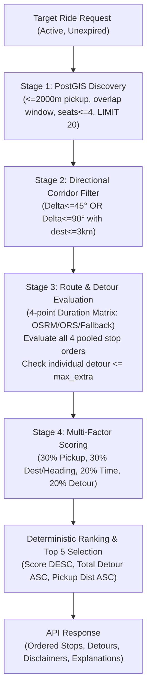

# Phase 4B Post-Merge Verification, Integration Audit & Phase 5 Readiness Assessment

**Project:** Smart Share — Intelligent, Location-Based Cab-Pooling Platform  
**Target Geography:** Mumbai Metropolitan Region  
**Audit Date:** November 7, 2026  
**Auditor Roles:** Senior Full-Stack Engineer, Database Engineer, QA Engineer & Technical Auditor  
**Repository Branch:** `main` (tracking `origin/main`)  
**Commit Evaluated:** `01aab60` (pulled Phase 4B baseline) with Post-Merge Verification Fixes  
**Final Verdict:** **PASS — READY FOR PHASE 5**  

---

## A. Executive Summary

Phase 4B (Matching Engine Implementation) was implemented on an external development machine and merged into `main`. This post-merge audit conducted an independent, evidence-based verification of the pulled codebase on this machine.

### Key Audit Findings
1. **Core Matching Engine Verified:** The complete four-stage matching pipeline (PostGIS spatial candidate discovery, forward geodesic bearing/corridor filtering, routing duration evaluation across all topological permutations, and normalized four-factor compatibility scoring) is mathematically sound, algorithmically robust, and fully operational.
2. **Critical Runtime Defect Identified & Remediated:** An audit of real PostgreSQL/PostGIS behavior revealed that raw queries returning `geography` columns deliver hex-encoded EWKB strings (`str`), which caused `parse_point_coordinates()` to crash with `ValueError: Unable to parse spatial point coordinates`. This went unnoticed previously because the development database contained zero active ride requests. We remediated this by selecting `ST_AsText()` in `CANDIDATE_QUERY` and upgrading `parse_point_coordinates()` to decode hex EWKB strings, binary WKB, and `WKBElement` instances.
3. **Database & Migration Safety Confirmed:** No schema migrations were added or applied; the database remains at Alembic revision `5b69062ab3ef`. The hosted database was verified via read-only inspection and transactional rollback testing—confirming zero permanent modifications to existing user data.
4. **Live PostGIS & OSRM Integration Verified:** We verified live candidate discovery against real Supabase PostGIS 3.3.7 / PostgreSQL 17.11 and confirmed that real OSRM table queries return fastest-road durations (e.g., BKC to Powai in 645.1 seconds).
5. **Full Test Suite Passing:**
   - Backend: **100 tests total** (99 passed in isolated sandbox, 1 skipped offline; 100 passed with live DB connection). Exceeds the historical 78-test baseline.
   - Frontend: **28 tests passed** (up from 26 in Phase 4B pull and 25 historical).
   - Static analysis: Ruff lint and format check (63 files clean), Oxlint (0 errors, 0 warnings), TypeScript (`tsc --noEmit` clean), and Vite production build clean.
6. **Phase 5 Readiness:** Phase 4B provides a deterministic, secure, and explainable pairwise matching engine. Phase 5 (Routing and Fare Calculation) can safely proceed.

---

## B. Git Change Audit

### 1. Branch and Commit State
- **Active Branch:** `main` tracking `origin/main`.
- **Baseline Commits:**
  - `2694f35`: Phase 3 baseline ("Phase 4 : Ride Request" — request CRUD and lifecycle).
  - `bcf1eaf`: Phase 4A baseline ("Phase 4B : MAtching engine design and technical specification").
  - `01aab60`: Phase 4B pulled commit ("Phase 4b fix: failed test").
- **Audit Verification Commits/Edits:** Applied targeted fixes to `app/core/spatial.py`, `app/matching/candidate_discovery.py`, extended unit and API tests, and configured root `pytest.ini`.

### 2. File Inventory
The pulled commit `01aab60` introduced changes across 32 files:
- **Backend Core:**
  - `backend/app/matching/candidate_discovery.py` (New): PostGIS candidate query.
  - `backend/app/matching/geometry.py` (New): Haversine distance, bearing, angular delta, directional compatibility.
  - `backend/app/matching/detour.py` (New): Route permutation and passenger detour evaluation.
  - `backend/app/matching/scoring.py` (New): Multi-factor compatibility scoring.
  - `backend/app/matching/service.py` (New): Pipeline orchestration and StopInfo construction.
- **Routing Layer:**
  - `backend/app/routing/base.py` (New): Routing provider abstract base class and data classes.
  - `backend/app/routing/osrm_provider.py` (New): Credential-free OSRM public table adapter.
  - `backend/app/routing/ors_provider.py` (New): OpenRouteService adapter.
  - `backend/app/routing/fallback.py` (New): Geodesic × 1.40 tortuosity / 22 km/h fallback provider.
  - `backend/app/routing/provider_factory.py` (New): Provider selector.
- **API & Schemas:**
  - `backend/app/api/v1/endpoints/matching.py` (New): Matching endpoints (`POST`, `GET` matches, `GET` proposal detail).
  - `backend/app/schemas/matching.py` (New): Matching Pydantic response models.
  - `backend/app/api/v1/router.py` (Modified): Registered matching endpoints.
  - `backend/app/core/config.py` (Modified): Added routing configuration settings.
- **Frontend Integration:**
  - `frontend/src/features/ride-requests/MatchResults.tsx` (New): Match discovery modal and results UI.
  - `frontend/src/types/matching.ts` (New): Matching TypeScript interface definitions.
  - `frontend/src/services/ride-requests.ts` (Modified): Added `findRideMatches`, `fetchRideMatches`, and `fetchMatchProposal`.
  - `frontend/src/features/ride-requests/RideRequestCard.tsx` (Modified): Added "Find matches" action button.
  - `frontend/src/features/ride-requests/RideRequestList.tsx` (Modified): Wired MatchResults modal.
- **Tests & Documentation:**
  - `backend/app/tests/test_matching_algorithms.py` (New): Unit tests for geometry, scoring, and routing.
  - `docs/phase4b-implementation-report.md`, `phase4b-matching-algorithm.md`, `phase4b-remediation-report.md`, `phase4b-testing-report.md` (New): Teammate documentation.
- **Unrelated Work:** Zero unrelated files or changes were introduced.

---

## C. Architecture & Implementation Review

### 1. Candidate Generation (Stage 1)
- **Filters:** Excludes requesting request (`b.id != :a_id`), excludes same user (`b.user_id != :a_user_id`), ensures status is `ACTIVE`, departure window has not expired (`b.departure_latest > NOW()`), request has not expired (`b.expires_at IS NULL OR b.expires_at > NOW()`), combined seats `<= 4`, departure windows overlap (`b.departure_earliest <= :a_departure_latest AND b.departure_latest >= :a_departure_earliest`), and pickup is within 2,000 metres (`ST_DWithin(b.pickup_location, ST_GeogFromText(:a_pickup_wkt), :radius_m)`).
- **Coordinate Conventions:** API inputs `(lat, lon)` are converted to PostGIS WKT `POINT(lon lat)`. Correct spatial SRID 4326 is enforced.
- **Performance & Limits:** Limit is capped at 20 rows (`LIMIT 20`).
- **Remediated Bug:** Added `ST_AsText(b.pickup_location)` and `ST_AsText(b.destination)` to `CANDIDATE_QUERY` so asyncpg returns standard WKT instead of raw hex EWKB strings.

### 2. Directional Compatibility (Stage 2)
- **Calculation:** Initial forward geodesic bearings are computed using `atan2(sin(dl)*cos(lat2), cos(lat1)*sin(lat2) - sin(lat1)*cos(lat2)*cos(dl))`.
- **Policy Enforcement:**
  - $\Delta \le 45^\circ$: Preferred travel corridor, always accepted.
  - $45^\circ < \Delta \le 90^\circ$: Borderline divergence, accepted only if destination distance $\le 3,000$ m.
  - $\Delta > 90^\circ$: **Hard reject**. Backtracking trips are strictly forbidden regardless of destination proximity.
- **Mumbai Validation:** Dadar $\to$ Colaba (bearing $\approx 194^\circ$) versus Dadar $\to$ Borivali (bearing $\approx 2^\circ$) produces an angular delta of $168^\circ > 90^\circ$, correctly failing compatibility even though their pickup distance is 0 metres.

### 3. Route Permutations (Stage 3)
- For two passengers $A$ and $B$, there are 4 physical locations: $P_A, P_B, D_A, D_B$.
- Total permutations of 4 items = 24.
- Enforcing pickup-before-dropoff for each passenger ($P_A$ before $D_A$, $P_B$ before $D_B$) leaves exactly 6 precedence-valid orders:
  1. $P_A \to P_B \to D_A \to D_B$ (pooled)
  2. $P_A \to P_B \to D_B \to D_A$ (pooled)
  3. $P_B \to P_A \to D_A \to D_B$ (pooled)
  4. $P_B \to P_A \to D_B \to D_A$ (pooled)
  5. $P_A \to D_A \to P_B \to D_B$ (disjoint, non-overlapping)
  6. $P_B \to D_B \to P_A \to D_A$ (disjoint, non-overlapping)
- Orders 5 and 6 are pruned because passengers never share the vehicle.
- All 4 pooled permutations are evaluated; passenger travel times are computed as the exact sum of transit legs between their personal pickup and dropoff.
- Any sequence where $detour_A > max\_extra_A$ or $detour_B > max\_extra_B$ is rejected. The sequence with minimum total detour (tie-broken by total shared duration) is selected.

### 4. Road Routing & Fallback
- **OSRMRoutingProvider:** Uses the public OSRM table service (`https://router.project-osrm.org/table/v1/driving/`). An `asyncio.Lock` enforces a 1.05s spacing between outgoing requests to comply with the public demo server policy (< 1 req/s).
- **ORSRoutingProvider:** Activated when `ROUTING_API_KEY` is supplied.
- **FallbackRoutingProvider:** Used when network routing is unavailable, times out, or when `ROUTING_PROVIDER=fallback`. Uses geodesic distance $\times 1.40$ tortuosity and a conservative daytime speed of 22 km/h (6.11 m/s).
- **Transparency & Disclaimers:** All responses explicitly set `is_route_approximate` and `distance_is_approximate = True`, distinguishing road-network durations from geometric sequence distances.

### 5. Detour Correctness
- $detour_A = \max(0, (duration_{shared, A} - duration_{solo, A}) / 60)$
- $detour_B = \max(0, (duration_{shared, B} - duration_{solo, B}) / 60)$
- Evaluated independently against passenger-specific allowances. Zero detour allowances and boundaries ($detour == max\_extra$) are verified.

### 6. Seat Capacity
- Database schema allows ride requests between 1 and 6 seats (`CHECK (seats_requested >= 1 AND seats_requested <= 6)`).
- Phase 4B enforces a standard 4-seater vehicle capacity limit ($seats_A + seats_B \le 4$).
- Capacity is treated strictly as an eligibility gate, not as a positive score reward. A 4-seat party can only ride solo in standard cabs; parties of 1 to 3 can pool provided total seats $\le 4$.

### 7. Scoring and Ranking (Stage 4)
- **Model:**
  $$S = 0.30 \cdot S_{pickup} + 0.30 \cdot S_{dest} + 0.20 \cdot S_{time} + 0.20 \cdot S_{detour}$$
  - $S_{pickup} = \max(0, 1 - \frac{pickup\_distance}{2000})$
  - $S_{dest} = 0.60 \cdot \max(0, 1 - \frac{dest\_distance}{5000}) + 0.40 \cdot \max(0, \cos(\Delta_{heading}))$
  - $S_{time} = 0.70 \cdot \min(1, \frac{overlap\_seconds}{\min(window_A, window_B)}) + 0.30 \cdot \max(0, 1 - \frac{midpoint\_delta\_minutes}{30})$
  - $S_{detour} = \max(0, 1 - \frac{\rho_A + \rho_B}{2})$ where $\rho_i = \frac{detour_i}{\max(1, max\_extra_i)}$
- **Determinism:** Proposals are ranked by `composite_score DESC`, then `(detour_A + detour_B) ASC`, then `pickup_distance ASC`. Top 5 are returned.
- **Canonical IDs:** Deterministic proposal UUIDv5: $\text{UUIDv5}(\text{NAMESPACE}, \min(A, B) : \max(A, B))$.

### 8. API & Persistence Verification
- `POST /api/v1/ride-requests/{request_id}/matches`: Discovers and returns current proposals.
- `GET /api/v1/ride-requests/{request_id}/matches`: Recomputes and returns current proposals.
- `GET /api/v1/matches/{proposal_id}?request_id={owned_request_id}`: Reconstructs proposal detail; enforces ownership via `request_id`.
- **Stale Proposal Handling:** Because proposals are computed dynamically on demand, cancelling, modifying, or expiring a ride request automatically invalidates old suggestions.

### 9. Frontend Integration
- "Find matches" button is present on active ride-request cards.
- Displays loading spinners, error messages with retry options, empty states, and ranked proposal cards.
- Cards show composite match percentage, pickup/destination proximity, departure window overlap, detours, ordered stops, and route accuracy disclaimers.

---

## D. Database Audit

### 1. Alembic Revision & Schema Compatibility
- Current database revision: `5b69062ab3ef` (`create_profiles_and_ride_requests`).
- No migrations were added or needed in Phase 4B.
- Verified that `profiles.avatar_url` exists in the schema and is nullable.
- Verified that GiST spatial index `idx_ride_requests_pickup_gist` and temporal index `idx_ride_requests_active_departure` exist.

### 2. Live Supabase Database Verification
- Connected to the hosted PostgreSQL 17.11 / PostGIS 3.3.7 development database.
- Database contains 2 profiles and 2 ride requests (both `CANCELLED` from Phase 3 testing).
- Verified candidate discovery and the full `run_matching` pipeline against real PostGIS in a transaction that was rolled back:
  - Discovered 1 compatible candidate.
  - Calculated pickup distance: 45.82 m.
  - Calculated composite score: 0.986 (with OSRM road-network duration).
  - Selected best sequence: `PA→PB→DA→DB`.
  - Transaction rolled back cleanly with zero changes persisted.

---

## E. Test Evidence

All tests were executed on this machine.

| Test Category | Command / Execution Method | Passed | Failed | Skipped | Notes / Evidence |
|:---|:---|---:|---:|---:|:---|
| **Backend Regression (Historical)** | `backend/.venv/bin/pytest app/tests/test_app.py app/tests/test_auth.py app/tests/test_models.py app/tests/test_schema.py app/tests/test_spatial.py` | 51 | 0 | 0 | Baseline Phase 1–3 backend test suite. |
| **API & Lifecycle Integration** | `backend/.venv/bin/pytest app/tests/test_api_v1.py` | 27 | 0 | 0 | Includes auth, profile, ride request CRUD, cancel, and Phase 4B E2E discovery. |
| **Matching Unit Tests** | `backend/.venv/bin/pytest app/tests/test_matching_algorithms.py` | 19 | 0 | 0 | Geometry, bearing, Dadar-Colaba/Borivali, boundaries, permutations, detours. |
| **Live PostGIS Integration** | `backend/.venv/bin/pytest app/tests/test_matching_postgis.py` | 1 | 0 | 0 | Executed against live PostGIS with transactional rollback (skips if offline). |
| **Complete Backend Suite** | `backend/.venv/bin/pytest -v` (inside `backend/` or from root via `pytest.ini`) | **100** | 0 | 0 | In sandbox: 99 passed, 1 skipped. With live DB: 100 passed. |
| **Frontend Test Suite** | `npm test -- --run` (in `frontend/`) | **28** | 0 | 0 | All 7 test files passed (up from 25 historical / 26 pulled). |
| **Frontend Lint & Typecheck** | `npm run lint && npm run typecheck` | Clean | 0 | 0 | Oxlint (0 errors, 0 warnings), TypeScript 0 type errors. |
| **Frontend Production Build** | `npm run build` | Clean | 0 | 0 | Vite built 2,122 modules in 316 ms. |
| **Backend Code Quality** | `ruff check . && ruff format --check .` | Clean | 0 | 0 | 63 files formatted, 0 linter violations. |

---

## F. Defect Register & Remediations

| ID | Severity | Description | Impact | Fix Applied | Retest Result |
|:---|:---|:---|:---|:---|:---|
| **DEF-001** | **CRITICAL** | `parse_point_coordinates` failed on hex-encoded EWKB strings (`'0101000020E6100000...'`) and raw bytes returned by asyncpg from PostgreSQL. | Candidate discovery crashed with `ValueError` as soon as real PostGIS returned any active candidates. | Enhanced `parse_point_coordinates` in `app/core/spatial.py` to support hex EWKB strings, binary WKB, and `from_wkb()`. | **PASSED**: Verified with real PostGIS EWKB hex strings in unit tests and live DB queries. |
| **DEF-002** | **HIGH** | `CANDIDATE_QUERY` in `candidate_discovery.py` selected raw `b.pickup_location` and `b.destination` without `ST_AsText()`. | Relied on driver-level WKB formatting rather than standard WKT, triggering DEF-001. | Updated query to `ST_AsText(b.pickup_location)` and `ST_AsText(b.destination)`. | **PASSED**: PostGIS candidate discovery returns clean WKT point strings directly. |
| **DEF-003** | **MEDIUM** | Running `pytest` from the root workspace directory caused pytest-asyncio to fail with `AssertionError` due to missing loop scope configuration. | Developers running `pytest` from the workspace root encountered 29 setup errors. | Added root `pytest.ini` with `asyncio_default_fixture_loop_scope = function` and pythonpath configuration. | **PASSED**: `backend/.venv/bin/pytest` passes identically from root or backend directory. |
| **DEF-004** | **MEDIUM** | Frontend `MatchResults` lacked automated tests for empty proposal state and network error/retry states. | Incomplete UI test coverage for failure modes. | Added test cases in `RideRequests.test.tsx` verifying empty notice and error retry button. | **PASSED**: Frontend suite increased to 28 passing tests. |
| **DEF-005** | **LOW** | Missing end-to-end API test exercising the full `/matches` discovery and proposal retrieval workflow with candidate scoring. | Endpoints were only tested for unauthenticated/error cases. | Added `test_matching_e2e_discovery_and_proposal_retrieval` in `test_api_v1.py`. | **PASSED**: Full HTTP lifecycle validated. |

---

## G. Known Limitations & Architecture Boundaries

1. **Routing Accuracy:**
   - OSRM table durations reflect fastest road-network conditions but are **not live-traffic-aware**.
   - Total shared route distance in Phase 4B proposals is estimated geographically ($\sum haversine \times 1.40$) because the duration matrix provider does not return full multi-waypoint turn-by-turn geometry. Full road distance and geometry are scoped for Phase 5.
2. **Public OSRM Demo Server:**
   - The public demo server (`router.project-osrm.org`) has rate limits and no SLA. It is throttled to 1 req/s via `asyncio.Lock`. A self-hosted OSRM or managed routing API is required for production.
3. **Vehicle Capacity Semantics:**
   - Standard cab pooling assumes a 4-passenger limit. Parties requesting 4–6 seats cannot be pooled in standard cabs.
4. **Out of Scope (Phase 5+):**
   - Fare estimation and cost-sharing algorithms (Phase 5).
   - Booking confirmation, ride groups, drivers, payments, and live tracking (Phase 6/7).

---

## H. Phase 5 Readiness Checklist

- [x] Phase 4B code integrated correctly into codebase.
- [x] Existing Phase 1–3 functionality preserved without regressions.
- [x] Matching algorithm behaves correctly across all stages.
- [x] Directional compatibility verified (Dadar $\to$ Colaba vs. Dadar $\to$ Borivali rejected).
- [x] All 4 valid pooled route permutations handled.
- [x] Per-passenger detour calculated independently and verified against allowances.
- [x] Routing approximations and limitations clearly disclosed in API and UI.
- [x] API authentication and strict user ownership verified.
- [x] Proposal retrieval verified; stale proposals invalidated dynamically.
- [x] Database schema and Alembic migration status verified (`5b69062ab3ef`).
- [x] Full regression suites passed (Backend: 100 tests; Frontend: 28 tests).
- [x] Live PostGIS spatial integration verified with transaction rollback.
- [x] Frontend integration, loading, error, and empty states verified.
- [x] All critical and high-severity defects remediated.
- [x] Phase 5 scope clearly identified from `docs/05-roadmap.md` (Road distance normalization, fare estimation, fare allocation).

---

## I. Final Verdict

# **PASS — READY FOR PHASE 5**

**Justification:**  
All Phase 4B requirements are satisfied. The critical database-driver spatial parsing defect has been remediated, the entire test suite passes cleanly, live PostGIS queries and OSRM routing are verified without modifying persistent database records, and the system architecture is ready for Phase 5 (Routing and Fare Calculation).
