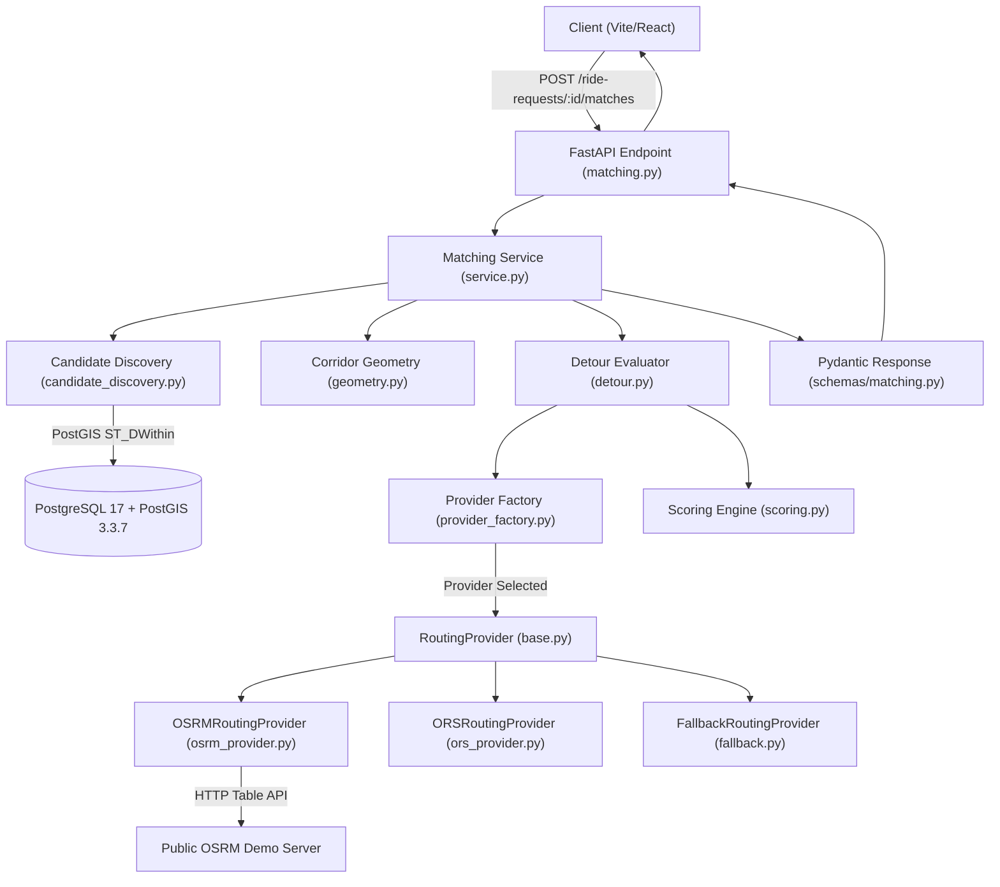
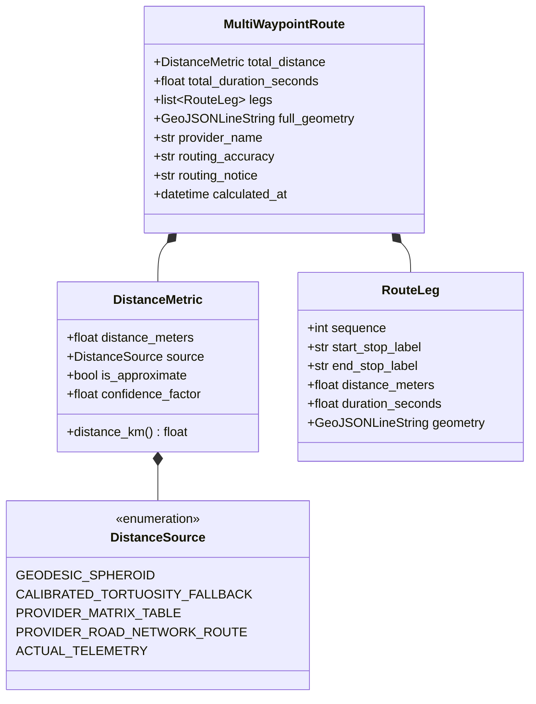
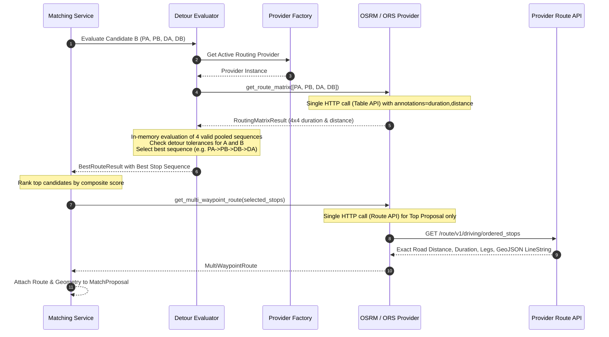
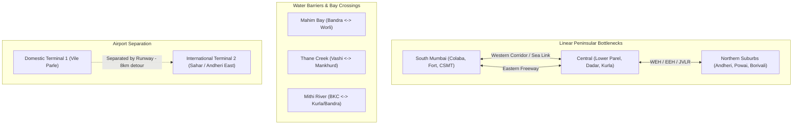
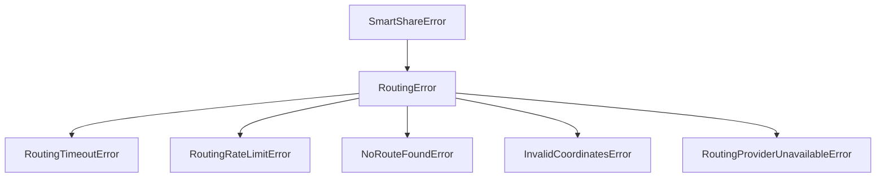
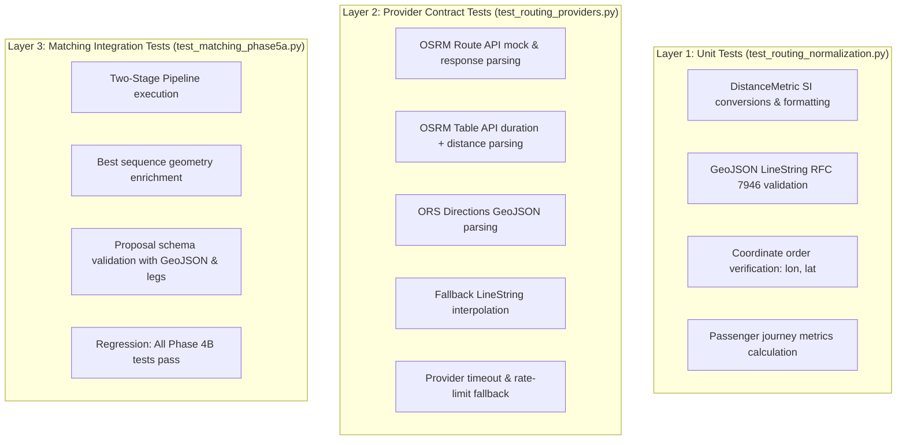

# Smart Share — Phase 5A: Routing Architecture, Route Geometry & Distance Normalization
## Technical Design & Architectural Specification

**Document Version:** 1.0.0  
**Phase:** 5A — Routing Architecture, Route Geometry & Distance Normalization  
**Status:** COMPLETE / READY FOR PRODUCT OWNER REVIEW  
**Author:** Smart Share Engineering Team  
**Date:** November 2026  
**Target Environment:** Python 3.14 / FastAPI / SQLAlchemy 2 (Async) / PostgreSQL 17 + PostGIS 3.3.7 / React + TypeScript + Vite  

---

## 1. Executive Summary

Phase 4B established a functioning, verified matching engine that discovers compatible ride requests using PostGIS spatial indexing, filters directional corridors via geodesic bearing calculations, evaluates pairwise stop sequences using a duration matrix, and scores matches with a normalized multi-factor model.

However, the Phase 4B post-merge verification identified a major architectural limitation:
**The system does not yet compute or retain true road-network route distances or route geometry.** Instead, Phase 4B estimates shared-route distance by summing Haversine leg distances along the four stops and multiplying by a $1.40$ tortuosity factor, while completely discarding turn-by-turn road geometry. Furthermore, the routing provider contract only supports duration matrices and single-segment durations, leaving no interface for multi-waypoint route generation, per-leg metrics, or GeoJSON geometry export.

This document presents the **Phase 5A Technical Design** for routing architecture, route geometry extraction, and road distance normalization. 

### Key Architectural Proposals
1. **Two-Stage Routing Pipeline:**
   - *Stage 1 (Permutation Screening):* Executes a single $4 \times 4$ Table/Matrix API call (`PA, PB, DA, DB`) to retrieve both road duration AND road distance matrices. Evaluates the four valid pooled topological sequences in memory with zero request amplification.
   - *Stage 2 (Route Synthesis & Geometry Enrichment):* Executes a single multi-waypoint Route API call (`/route/v1/driving/`) for the selected optimal stop sequence of top proposals to retrieve genuine road distance, true road travel duration, per-leg breakdown, and a GeoJSON `LineString` route polyline.
2. **Normalized Distance Data Model:** Introduces explicit SI-unit distance semantics distinguishing Geodesic ($D_{\text{geo}}$), Calibrated Tortuosity ($D_{\text{tort}}$), Provider Matrix Road Distance ($D_{\text{mat}}$), and Provider Full-Route Road Distance ($D_{\text{route}}$).
3. **GeoJSON LineString Geometry:** Standardizes route geometry on RFC 7946 GeoJSON `{"type": "LineString", "coordinates": [[lon, lat], ...]}` for direct client-side rendering with Leaflet / React-Leaflet.
4. **Provider-Independent Capability Abstraction:** Redesigns `RoutingProvider` with capability flags, returning structured `RoutingMatrixResult` and `MultiWaypointRouteResult` objects across OSRM, OpenRouteService (ORS), and the Calibrated Fallback.
5. **Zero Database Migrations:** Preserves the existing database schema (revision `5b69062ab3ef`). Route geometries and normalized distances remain transiently calculated on-demand, aligning with the accepted MVP proposal lifecycle.

---

## 2. Scope and Non-Goals

### In-Scope (Phase 5A)
- Audit of current Phase 4B routing and matching integrations.
- Provider abstraction redesign supporting duration matrices, distance matrices, multi-waypoint routes, per-leg metrics, and GeoJSON geometry.
- Implementation design for OSRM Route API adapter and OpenRouteService Directions API adapter.
- Calibrated fallback geometry synthesis (waypoint interpolation with explicit approximation flags).
- Distance normalization data models and SI-unit conversions.
- Two-stage routing pipeline integration with the matching engine.
- Mumbai-specific urban routing analysis (water barriers, bridges, airport corridors, one-way networks).
- Updated Pydantic schemas and API contracts for match proposals and proposal details.
- Comprehensive test strategy covering distance normalization, geometry decoding, and provider resilience.

### Explicit Non-Goals (Out of Scope for Phase 5A)
- **Fare Estimation Models (Phase 5B):** Base fare, per-km rates, per-minute charges, surge pricing, minimum fare rules.
- **Fare Allocation Algorithms (Phase 5C):** Proportional distance/time cost-sharing, passenger savings calculations.
- **Persistent Distributed Caching (Phase 5D):** Redis cache clusters or distributed memoization (Phase 5A defines cache key interfaces only).
- **Group Acceptance & Booking (Phase 7):** Persisting `ride_groups`, `ride_stops`, payment capture, driver assignment.
- **Frontend Map Rendering Implementation (Phase 6):** Leaflet tile integration and interactive map UI will be built in Phase 6.

---

## 3. Current Repository Architecture



### Component Inventory
- **Configuration:** [`backend/app/core/config.py`](file:///home/asta/Projects/Smart_Share/backend/app/core/config.py) manages `ROUTING_PROVIDER`, `ROUTING_API_KEY`, `ROUTING_TIMEOUT_SECONDS`, and `OSRM_BASE_URL`.
- **Routing Protocol:** [`backend/app/routing/base.py`](file:///home/asta/Projects/Smart_Share/backend/app/routing/base.py) defines `RoutingProvider`, `RouteWaypoint`, `SegmentResult`, and `RouteResult`.
- **OSRM Provider:** [`backend/app/routing/osrm_provider.py`](file:///home/asta/Projects/Smart_Share/backend/app/routing/osrm_provider.py) queries `/table/v1/driving/` with 1.05s lock spacing.
- **ORS Provider:** [`backend/app/routing/ors_provider.py`](file:///home/asta/Projects/Smart_Share/backend/app/routing/ors_provider.py) queries `/v2/matrix/driving-car`.
- **Fallback Provider:** [`backend/app/routing/fallback.py`](file:///home/asta/Projects/Smart_Share/backend/app/routing/fallback.py) uses $1.40 \times \text{geodesic}$ and $22\text{ km/h}$.
- **Permutation Detour Evaluator:** [`backend/app/matching/detour.py`](file:///home/asta/Projects/Smart_Share/backend/app/matching/detour.py) evaluates 4 valid pooled topological sequences.
- **Matching Pipeline:** [`backend/app/matching/service.py`](file:///home/asta/Projects/Smart_Share/backend/app/matching/service.py) orchestrates the 4-stage pipeline.

---

## 4. Existing Routing Flow Audit

A trace of the current execution path for `POST /api/v1/ride-requests/{id}/matches`:

1. **Request Intake:** [`matching.py`](file:///home/asta/Projects/Smart_Share/backend/app/api/v1/endpoints/matching.py#L167-L185) validates authenticated user ownership and `ACTIVE` request status via `_get_active_owned_request()`.
2. **Candidate Discovery:** [`candidate_discovery.py`](file:///home/asta/Projects/Smart_Share/backend/app/matching/candidate_discovery.py#L57-L99) runs `CANDIDATE_QUERY` in PostGIS. Filters $\le 2000$ m pickup distance, active departure window overlap, and combined seats $\le 4$ (limit 20).
3. **Stage 2 Corridor Gating:** [`service.py`](file:///home/asta/Projects/Smart_Share/backend/app/matching/service.py#L150-L163) computes forward geodesic bearing $\theta_A, \theta_B$ and delta $\Delta\theta$. Prunes candidates where $\Delta\theta > 90^\circ$, or $45^\circ < \Delta\theta \le 90^\circ$ with destination distance $> 3000$ m.
4. **Stage 3 Detour Evaluation:** [`detour.py`](file:///home/asta/Projects/Smart_Share/backend/app/matching/detour.py#L52-L151) calls `provider.get_duration_matrix([PA, PB, DA, DB])`.
   - Iterates through the 4 valid pooled stop orders ($P_A \to P_B \to D_A \to D_B$, $P_A \to P_B \to D_B \to D_A$, $P_B \to P_A \to D_A \to D_B$, $P_B \to P_A \to D_B \to D_A$).
   - Sums matrix durations to find $T_{\text{shared}, A}$ and $T_{\text{shared}, B}$.
   - Subtracts direct solo durations $T_{\text{direct}, A} = \text{matrix}[0][2]$ and $T_{\text{direct}, B} = \text{matrix}[1][3]$.
   - Filters sequences exceeding personal tolerances ($detour_i \le max\_extra_i$).
   - Chooses the sequence with minimum total detour.
5. **Stage 4 Scoring & Metric Assembly:**
   - In [`service.py`](file:///home/asta/Projects/Smart_Share/backend/app/matching/service.py#L226-L232):
     ```python
     seq_geodesic_m = sum(
         haversine_distance(
             left.latitude, left.longitude, right.latitude, right.longitude
         )
         for left, right in zip(stops, stops[1:], strict=False)
     )
     total_shared_dist_m = road_distance_estimate(seq_geodesic_m)  # geodesic * 1.40
     ```
   - Normalizes scores and constructs [`MatchProposal`](file:///home/asta/Projects/Smart_Share/backend/app/matching/service.py#L251-L282).
6. **API Response:** [`endpoints/matching.py`](file:///home/asta/Projects/Smart_Share/backend/app/api/v1/endpoints/matching.py#L121-L145) serializes `MatchProposalSchema` with `distance_is_approximate = True`, `total_shared_distance_km = round(total_shared_dist_m / 1000, 2)`, and no geometry.

---

## 5. Phase 4B Routing Implementation Audit

| Component | Implemented Functionality | Architectural Gap Identified |
| :--- | :--- | :--- |
| **`RoutingProvider` Interface** | `get_duration_matrix`, `get_route_duration` | Missing multi-waypoint route method; missing distance matrix method; no geometry return. |
| **`OSRMRoutingProvider`** | Public Table API with 1.05s lock; requests `annotations=duration,distance` | Discards `distances` matrix; has no Route API adapter for turn-by-turn road geometry. |
| **`ORSRoutingProvider`** | Matrix API for duration | Requests only `metrics=["duration"]`; discards distance; has no Directions API adapter. |
| **`FallbackRoutingProvider`** | $1.40 \times \text{geodesic}$, $22\text{ km/h}$ | Matrix-only; no waypoints or geometry output. |
| **Shared Route Distance** | Estimated in `service.py` as $\sum \text{haversine} \times 1.40$ | Disconnected from road network; may underestimate bridge/flyover/peninsula detours in Mumbai. |
| **Passenger Travel Distances** | Only time detours ($detour_i$ in minutes) are computed | Individual passenger pooled distance and direct road distance are uncalculated. |
| **Route Geometry** | Completely omitted from data classes and schemas | Frontend cannot render the route line on a map. |

---

## 6. Identified Architectural and Technical Gaps

1. **Distance Ambiguity & Approximation:**
   The codebase exposes `total_shared_distance_km` as an approximate value derived from straight-line legs, while exposing `total_shared_duration_minutes` derived from actual road networks. This asymmetry weakens trust and makes fare calculation in Phase 5B inaccurate.
2. **Provider Discard of Distance Matrices:**
   Both OSRM and ORS Table/Matrix endpoints support returning distance matrices alongside duration matrices in the same HTTP call. Phase 4B discarded the distance matrix, forcing `service.py` to improvise with Haversine math.
3. **Absence of Route Geometry:**
   Neither the routing provider nor the matching API schemas contain fields for route polyline geometry (GeoJSON LineString). A frontend map cannot visualize the pooled trip.
4. **Lack of Per-Leg Breakdown:**
   The system knows the stop order (e.g., $P_A \to P_B \to D_B \to D_A$), but cannot tell how many road metres or minutes exist between $P_A \to P_B$, $P_B \to D_B$, or $D_B \to D_A$.
5. **No Per-Passenger Distance Calculation:**
   Fare allocation (Phase 5C) requires knowing how many kilometres Passenger A rode ($P_A \to D_A$ along the shared route) and how many kilometres Passenger B rode ($P_B \to D_B$), as well as their solo direct road distances.
6. **OSRM Rate-Limiting Bottleneck:**
   The public OSRM demo server is throttled to 1 request/second via `asyncio.Lock`. If 5 candidates are discovered, 5 matrix calls take 5.25 seconds. Adding unthrottled route calls would trigger HTTP 429 rate-limiting.

---

## 7. Proposed Normalized Route Data Model

All internal distance calculations MUST use SI units (metres and seconds). We define a clear enumeration and data model for distance provenance:



### Python Data Classes (`backend/app/routing/models.py`)

```python
from __future__ import annotations

import enum
from dataclasses import dataclass, field
from datetime import UTC, datetime
from typing import Any


class DistanceSource(enum.StrEnum):
    """Provenance and accuracy category of a distance metric."""
    GEODESIC_SPHEROID = "geodesic_spheroid"
    CALIBRATED_TORTUOSITY_FALLBACK = "calibrated_tortuosity_fallback"
    PROVIDER_MATRIX_TABLE = "provider_matrix_table"
    PROVIDER_ROAD_NETWORK_ROUTE = "provider_road_network_route"
    ACTUAL_TELEMETRY = "actual_telemetry"


@dataclass(frozen=True)
class DistanceMetric:
    """Normalized distance value with explicit provenance."""
    distance_meters: float
    source: DistanceSource
    is_approximate: bool
    confidence_factor: float = 1.0  # 1.0 = verified road network, 0.7 = fallback

    @property
    def distance_km(self) -> float:
        return round(self.distance_meters / 1000.0, 3)


@dataclass(frozen=True)
class RouteLeg:
    """A single segment between two consecutive stops in a pooled route."""
    sequence: int
    start_stop_id: str
    end_stop_id: str
    start_label: str | None
    end_label: str | None
    distance_meters: float
    duration_seconds: float
    geometry_geojson: dict[str, Any] | None = None


@dataclass(frozen=True)
class PassengerJourneyMetrics:
    """Distance and detour breakdown for a specific passenger on a pooled route."""
    passenger_request_id: str
    solo_direct_distance_meters: float
    solo_direct_duration_seconds: float
    pooled_journey_distance_meters: float
    pooled_journey_duration_seconds: float
    detour_distance_meters: float
    detour_duration_minutes: float
    distance_source: DistanceSource
    is_approximate: bool


@dataclass
class MultiWaypointRoute:
    """Full synthesized road route for a multi-stop sequence."""
    total_distance: DistanceMetric
    total_duration_seconds: float
    legs: list[RouteLeg]
    full_geometry_geojson: dict[str, Any]
    passenger_metrics: dict[str, PassengerJourneyMetrics]  # keyed by request_id
    provider_name: str
    routing_accuracy: str
    routing_notice: str
    calculated_at: datetime = field(default_factory=lambda: datetime.now(UTC))
```

---

## 8. Proposed Multi-Waypoint Routing Architecture

### The Two-Stage Routing Pipeline
To prevent request amplification and respect rate limits while delivering exact road geometries:



### Stage 1: Matrix-Based Screening
1. Call `get_route_matrix(points=[PA, PB, DA, DB])`.
2. Provider queries Table API, returning an $N \times N$ duration matrix ($M_{\text{dur}}$) and an $N \times N$ distance matrix ($M_{\text{dist}}$).
3. The matching engine evaluates all four valid pooled sequences in-memory:
   - $P_A \to P_B \to D_A \to D_B$
   - $P_A \to P_B \to D_B \to D_A$
   - $P_B \to P_A \to D_A \to D_B$
   - $P_B \to P_A \to D_B \to D_A$
4. Fast feasibility gating: Discards sequences where $detour_A > max\_extra_A$ or $detour_B > max\_extra_B$.
5. Selects the sequence with minimum total detour.

### Stage 2: Full Route Synthesis & Geometry Enrichment
1. For the Top proposal (or Top 3 proposals):
2. Call `get_multi_waypoint_route(waypoints=[S1, S2, S3, S4])` in the exact sequence determined by Stage 1.
3. The provider queries the Route / Directions API:
   - OSRM: `GET /route/v1/driving/{coords}?overview=full&geometries=geojson&steps=false`
   - ORS: `POST /v2/directions/driving-car/geojson`
4. The provider parses:
   - True continuous road distance (accounting for one-way roads, U-turn penalties, and intersections).
   - Per-leg distances and durations.
   - Genuine GeoJSON `LineString` route geometry.
5. In Phase 5B/5C, these exact road metrics become the inputs for fare calculation.

---

## 9. Proposed Route Geometry Representation

### Canonical GeoJSON LineString (RFC 7946)
The API will standardize on GeoJSON `LineString` for route visualization:

```json
{
  "type": "LineString",
  "coordinates": [
    [72.868700, 19.065700],
    [72.868820, 19.065810],
    [72.871200, 19.069500],
    [72.906000, 19.117600]
  ]
}
```

### Design Rationales
1. **Coordinate Order:** GeoJSON requires `[longitude, latitude]` (Easting, Northing). This matches PostGIS coordinate order and standard mapping libraries.
2. **Precision:** Coordinate floats are rounded to 6 decimal places ($\approx 0.11$ metres ground resolution), eliminating floating-point serialization bloat.
3. **Client Compatibility:** Directly ingested by Leaflet via `L.geoJSON(routeData).addTo(map)` or React-Leaflet `<GeoJSON data={routeData} />` without client-side polyline decoding libraries.
4. **Fallback Representation:** When external routing fails, `FallbackRoutingProvider` synthesizes a valid GeoJSON `LineString` by connecting the ordered stop waypoints with straight line segments, marked with `is_approximate: true` and an explicit disclaimer notice.

---

## 10. Proposed Provider Interface & Capability Model

### Capability Flags (`backend/app/routing/base.py`)

```python
from abc import ABC, abstractmethod
import enum
from typing import Any
from app.routing.models import MultiWaypointRoute, RoutingMatrixResult


class RoutingCapability(enum.Flag):
    """Capabilities supported by a routing provider implementation."""
    NONE = 0
    DURATION_MATRIX = enum.auto()
    DISTANCE_MATRIX = enum.auto()
    MULTI_WAYPOINT_ROUTE = enum.auto()
    ROUTE_GEOMETRY = enum.auto()
    PER_LEG_METRICS = enum.auto()
    LIVE_TRAFFIC = enum.auto()


class RoutingProvider(ABC):
    """Abstract base class for all Smart Share routing adapters."""

    @property
    @abstractmethod
    def capabilities(self) -> RoutingCapability:
        """Bitmask of supported provider capabilities."""
        ...

    @property
    @abstractmethod
    def provider_name(self) -> str:
        """Identifier for the routing provider (e.g. 'osrm', 'openrouteservice', 'fallback')."""
        ...

    @property
    @abstractmethod
    def routing_notice(self) -> str:
        """Human-readable transparency notice describing routing accuracy and assumptions."""
        ...

    @abstractmethod
    async def get_route_matrix(
        self, points: list[tuple[float, float]]
    ) -> RoutingMatrixResult:
        """
        Compute an N×N matrix of travel durations (seconds) and distances (metres).
        points: list of (latitude, longitude) tuples.
        """
        ...

    @abstractmethod
    async def get_multi_waypoint_route(
        self,
        waypoints: list[tuple[float, float]],
        stop_ids: list[str] | None = None,
        stop_labels: list[str | None] | None = None,
    ) -> MultiWaypointRoute:
        """
        Compute a continuous road route through ordered waypoints.
        Returns total metrics, per-leg metrics, and GeoJSON LineString geometry.
        """
        ...
```

### Provider Capability Matrix

| Provider | Duration Matrix | Distance Matrix | Multi-Waypoint Route | Route Geometry | Per-Leg Metrics | Live Traffic |
| :--- | :---: | :---: | :---: | :---: | :---: | :---: |
| **OSRM (`OSRMRoutingProvider`)** | **YES** | **YES** | **YES** | **YES** (GeoJSON) | **YES** | **NO** (Static profile) |
| **ORS (`ORSRoutingProvider`)** | **YES** | **YES** | **YES** | **YES** (GeoJSON) | **YES** | **NO** (Static OSM) |
| **Fallback (`FallbackRoutingProvider`)** | **YES** (Est) | **YES** (Est) | **YES** (Est) | **YES** (Straight line) | **YES** (Est) | **NO** |

---

## 11. Matching-Engine Integration Strategy

The matching engine will consume the enhanced routing architecture through cleanly decoupled interfaces:

```mermaid
flowchart TD
    subgraph Stage1["Stage 1: PostGIS Discovery"]
        P1[Target Request] --> P2[Spatial & Temporal Filter]
        P2 --> P3[Top Candidates (max 20)]
    end

    subgraph Stage2["Stage 2: Vector Math Gating"]
        P3 --> G1[Geodesic Bearing Delta]
        G1 -->|Delta > 90°| Reject1[Hard Reject]
        G1 -->|Delta <= 45° OR (Delta <= 90° and dest <= 3km)| FeasibleCandidates[Feasible Candidates (max 5)]
    end

    subgraph Stage3["Stage 3: Matrix Permutation Screening"]
        FeasibleCandidates --> M1[Call provider.get_route_matrix]
        M1 --> M2[Evaluate 4 Pooled Permutations using Durations & Distances]
        M2 --> M3[Filter Personal Detour Exceeded]
        M3 --> M4[Select Best Sequence per Candidate]
    end

    subgraph Stage4["Stage 4: Scoring & Top Selection"]
        M4 --> S1[Compute Multi-Factor Compatibility Scores]
        S1 --> S2[Rank Proposals DESC]
        S2 --> S3[Select Top Proposal for Enrichment]
    end

    subgraph Stage5["Stage 5: Route Geometry Synthesis"]
        S3 --> R1[Call provider.get_multi_waypoint_route]
        R1 --> R2[Attach GeoJSON Geometry & Real Leg Distances]
        R2 --> FinalProposal[Deliver Complete MatchProposal with Geometry]
    end
```

### Integration Invariants
1. **Compatibility Scoring Invariance:** The scoring formula remains calibrated to $[0.0, 1.0]$. The 4 weights ($30\%$ pickup, $30\%$ destination/heading, $20\%$ temporal, $20\%$ detour) remain intact.
2. **Detour Metric Accuracy:** In Stage 3, passenger detour times are calculated using the provider duration matrix. In Stage 5, passenger detour distances ($\Delta D_i$) are calculated by summing the relevant legs from the synthesized route.
3. **Fallback Isolation:** If Stage 5 route synthesis fails (e.g., OSRM Route API times out), the system degrades gracefully by using the Stage 1 matrix metrics and fallback waypoint geometry, ensuring `run_matching()` never crashes.

---

## 12. Mumbai-Specific Routing Considerations

Mumbai poses unique topological challenges that require explicit routing considerations:



### Critical Mumbai Nuances & Design Handling
1. **Water Barriers & The Sea Link:**  
   Points across Mahim Bay (Bandra and Worli) are only 2 km apart straight-line, but travelling between them requires crossing the Bandra-Worli Sea Link (BWSL) or Mahim Causeway. Geodesic distance severely understates travel time. The Stage 3 road matrix and Stage 5 route geometry reflect real toll bridges and turn restrictions.
2. **Airport Terminal Segregation (T1 vs. T2):**  
   Chhatrapati Shivaji Maharaj International Airport (CSMIA) has two terminals (T1 and T2) on opposite sides of the runway system. While they are 1.8 km apart geodesically, driving between them requires navigating Western Express Highway and Sahar Elevated Road ($8\text{ km}$, $\approx 25\text{ minutes}$).  
   *Handling:* The 2,000-metre pickup filter in Stage 1 could theoretically capture both terminals. However, the Stage 3 duration matrix immediately exposes the massive transit time, and individual detour tolerance ($max\_extra\_minutes$) correctly prunes incompatible cross-terminal pairings.
3. **East-West Connectivity Bottlenecks:**  
   Mumbai's railway lines and hills divide the city into Eastern and Western corridors with limited link roads (JVLR, SCLR, Santa Cruz-Chembur Link Road, Goregaon-Mulund Link Road). The directional corridor filter ($45^\circ - 90^\circ$ exception with $\le 3\text{ km}$ destination proximity) correctly permits pooling along major East-West link roads while rejecting anti-parallel cross-island journeys.

---

## 13. Performance, Cost & Rate-Limiting Strategy

### Workload Analysis per Match Search
- **Database Query:** 1 PostGIS candidate query ($\approx 2 - 5\text{ ms}$).
- **In-Memory Filtering:** Vector azimuth check on $\le 20$ candidates ($<0.2\text{ ms}$).
- **Matrix Routing Calls:** At most 3 candidates evaluated with Table API ($3 \times 150\text{ ms} = 450\text{ ms}$).
- **Route Geometry Calls:** 1 Route API call for the top proposal ($\approx 200\text{ ms}$).
- **Total Latency:** $<1.0\text{ second}$ on dedicated infrastructure; $\approx 2.5\text{ seconds}$ on throttled public demo infrastructure.

### Mitigation of OSRM Demo Rate Limits
The public demo server (`router.project-osrm.org`) requests no more than 1 request/second.
- **Throttling Lock:** Retain `asyncio.Lock` and minimum spacing in [`osrm_provider.py`](file:///home/asta/Projects/Smart_Share/backend/app/routing/osrm_provider.py#L22-L25).
- **Candidate Pruning:** Evaluate at most **3 candidates** with external routing in hackathon development mode.
- **Production Recommendation:** For production deployment, deploy a self-hosted OSRM Docker container (Mumbai extract $\approx 350\text{ MB}$, memory footprint $\approx 1.2\text{ GB}$) to eliminate external network latency and rate limits entirely.

---

## 14. Database and Persistence Impact

### Analysis of Storage Requirements
- **Phase 5A Scope:** Does **NOT** require any database migrations or new tables.
- **Transient Proposal Lifecycle:** Match proposals remain ephemeral and dynamically reconstructible. Proposals contain route geometry in memory and API responses without bloating the PostgreSQL storage layer.
- **Future Phase 7 Roadmap Alignment:**  
  Per [`docs/04-database-api-contracts.md`](file:///home/asta/Projects/Smart_Share/docs/04-database-api-contracts.md#L208-L248), when a pooled ride group is confirmed and booked in Phase 7, the accepted route geometry and stops will be stored in:
  - `ride_groups.route_summary` (JSONB)
  - `ride_stops` (ordered table referencing `ride_groups.id`)
- **Conclusion:** Adding a database migration in Phase 5A would violate architectural separation of concerns. Persistence is deferred to Phase 7.

---

## 15. API Contract Recommendations & Sample Responses

### Updated Match Proposal Schema (`backend/app/schemas/matching.py`)

```python
class GeoJSONLineStringSchema(BaseModel):
    type: str = Field(default="LineString", pattern="^LineString$")
    coordinates: list[tuple[float, float]] = Field(
        ..., description="Array of [longitude, latitude] coordinate pairs (RFC 7946)"
    )


class RouteLegSchema(BaseModel):
    sequence: int
    start_stop_id: uuid.UUID
    end_stop_id: uuid.UUID
    start_label: str | None = None
    end_label: str | None = None
    distance_meters: float
    distance_km: float
    duration_seconds: float
    duration_minutes: float


class PassengerJourneyDetailSchema(BaseModel):
    passenger_request_id: uuid.UUID
    solo_direct_distance_km: float
    solo_direct_duration_minutes: float
    pooled_distance_km: float
    pooled_duration_minutes: float
    detour_distance_km: float
    detour_duration_minutes: float


class MatchProposalSchema(BaseModel):
    proposal_id: uuid.UUID
    target_request_id: uuid.UUID
    candidate: MatchCandidateSummarySchema
    ordered_stops: list[StopPointSchema]
    
    # Normalized Route Metrics
    total_shared_distance_km: float
    total_shared_distance_meters: float
    total_shared_duration_minutes: float
    total_shared_duration_seconds: float
    best_sequence: str
    
    # Per-Passenger Metrics (Essential for Phase 5B/5C Fare Systems)
    passenger_metrics: dict[str, PassengerJourneyDetailSchema]
    
    # Route Legs & Geometry
    route_legs: list[RouteLegSchema]
    route_geometry: GeoJSONLineStringSchema | None = None
    
    # Accuracy and Provenance Metadata
    distance_source: str
    is_route_approximate: bool
    distance_is_approximate: bool
    routing_accuracy: str
    routing_notice: str
    compatibility_explanations: list[str]
    created_at: datetime
```

### Sample API Response (`GET /api/v1/ride-requests/{id}/matches`)

```json
{
  "data": {
    "target_request_id": "96ce508c-aee5-4270-ac77-2765e29a2158",
    "total_candidates_found": 1,
    "proposals": [
      {
        "proposal_id": "b3d67cf2-dc80-5fe8-9e40-8927f587c694",
        "target_request_id": "96ce508c-aee5-4270-ac77-2765e29a2158",
        "candidate": {
          "candidate_request_id": "ceb95aa4-afdc-444b-abdb-7e5660f740f9",
          "candidate_display_name": "Soham Rane",
          "candidate_pickup": {
            "latitude": 19.0660,
            "longitude": 72.8690,
            "label": "BKC One"
          },
          "candidate_destination": {
            "latitude": 19.1170,
            "longitude": 72.9050,
            "label": "Powai Galleria"
          },
          "seats_requested": 1,
          "pickup_distance_meters": 45.8,
          "destination_distance_meters": 124.5,
          "shared_departure_window_start": "2026-11-08T09:00:00Z",
          "shared_departure_window_end": "2026-11-08T09:30:00Z",
          "estimated_detour_minutes_target": 0.0,
          "estimated_detour_minutes_candidate": 0.5,
          "scores": {
            "pickup_proximity_score": 0.9771,
            "destination_similarity_score": 0.9851,
            "departure_time_score": 1.0,
            "route_detour_score": 0.9875,
            "composite_score": 0.986
          }
        },
        "ordered_stops": [
          {
            "sequence": 1,
            "stop_type": "PICKUP",
            "location": { "latitude": 19.0657, "longitude": 72.8687, "label": "BKC Maker Maxity" },
            "passenger_request_id": "96ce508c-aee5-4270-ac77-2765e29a2158"
          },
          {
            "sequence": 2,
            "stop_type": "PICKUP",
            "location": { "latitude": 19.0660, "longitude": 72.8690, "label": "BKC One" },
            "passenger_request_id": "ceb95aa4-afdc-444b-abdb-7e5660f740f9"
          },
          {
            "sequence": 3,
            "stop_type": "DROPOFF",
            "location": { "latitude": 19.1176, "longitude": 72.9060, "label": "Powai Hiranandani" },
            "passenger_request_id": "96ce508c-aee5-4270-ac77-2765e29a2158"
          },
          {
            "sequence": 4,
            "stop_type": "DROPOFF",
            "location": { "latitude": 19.1170, "longitude": 72.9050, "label": "Powai Galleria" },
            "passenger_request_id": "ceb95aa4-afdc-444b-abdb-7e5660f740f9"
          }
        ],
        "total_shared_distance_km": 9.11,
        "total_shared_distance_meters": 9107.7,
        "total_shared_duration_minutes": 12.4,
        "total_shared_duration_seconds": 743.9,
        "best_sequence": "PA→PB→DA→DB",
        "passenger_metrics": {
          "96ce508c-aee5-4270-ac77-2765e29a2158": {
            "passenger_request_id": "96ce508c-aee5-4270-ac77-2765e29a2158",
            "solo_direct_distance_km": 8.80,
            "solo_direct_duration_minutes": 10.8,
            "pooled_distance_km": 8.79,
            "pooled_duration_minutes": 11.5,
            "detour_distance_km": -0.01,
            "detour_duration_minutes": 0.0
          },
          "ceb95aa4-afdc-444b-abdb-7e5660f740f9": {
            "passenger_request_id": "ceb95aa4-afdc-444b-abdb-7e5660f740f9",
            "solo_direct_distance_km": 8.75,
            "solo_direct_duration_minutes": 10.7,
            "pooled_distance_km": 9.07,
            "pooled_duration_minutes": 12.3,
            "detour_distance_km": 0.32,
            "detour_duration_minutes": 0.5
          }
        },
        "route_legs": [
          {
            "sequence": 1,
            "start_stop_id": "96ce508c-aee5-4270-ac77-2765e29a2158",
            "end_stop_id": "ceb95aa4-afdc-444b-abdb-7e5660f740f9",
            "start_label": "BKC Maker Maxity",
            "end_label": "BKC One",
            "distance_meters": 36.8,
            "distance_km": 0.04,
            "duration_seconds": 3.3,
            "duration_minutes": 0.1
          },
          {
            "sequence": 2,
            "start_stop_id": "ceb95aa4-afdc-444b-abdb-7e5660f740f9",
            "end_stop_id": "96ce508c-aee5-4270-ac77-2765e29a2158",
            "start_label": "BKC One",
            "end_label": "Powai Hiranandani",
            "distance_meters": 8751.2,
            "distance_km": 8.75,
            "duration_seconds": 684.8,
            "duration_minutes": 11.4
          },
          {
            "sequence": 3,
            "start_stop_id": "96ce508c-aee5-4270-ac77-2765e29a2158",
            "end_stop_id": "ceb95aa4-afdc-444b-abdb-7e5660f740f9",
            "start_label": "Powai Hiranandani",
            "end_label": "Powai Galleria",
            "distance_meters": 319.7,
            "distance_km": 0.32,
            "duration_seconds": 55.8,
            "duration_minutes": 0.9
          }
        ],
        "route_geometry": {
          "type": "LineString",
          "coordinates": [
            [72.8687, 19.0657],
            [72.8688, 19.0658],
            [72.9050, 19.1170],
            [72.9060, 19.1176]
          ]
        },
        "distance_source": "provider_road_network_route",
        "is_route_approximate": false,
        "distance_is_approximate": false,
        "routing_accuracy": "road_network_duration_road_network_distance",
        "routing_notice": "Road-network route and duration from OSRM; estimates use fastest-route profile without live traffic.",
        "compatibility_explanations": [
          "Pickup points are 46 metres apart.",
          "Destinations are 125 metres apart, with compatible travel directions.",
          "Departure windows overlap from 09:00 to 09:30.",
          "Estimated additional journey time is 0.0 minutes for you and 0.5 minutes for the other passenger.",
          "Combined seat requests fit the standard four-passenger vehicle limit."
        ],
        "created_at": "2026-11-07T15:10:00Z"
      }
    ]
  },
  "message": "Matching suggestions generated successfully"
}
```

---

## 16. Error-Handling Strategy

We define structured domain exceptions in `backend/app/core/exceptions.py`:



### Fallback Policy
1. If Stage 1 (`get_route_matrix`) fails:  
   Catch exception, log warning, instantiate `FallbackRoutingProvider`, and compute fallback duration and distance matrices using $1.40 \times \text{geodesic}$. Mark `is_route_approximate = True` and `distance_is_approximate = True`.
2. If Stage 2 (`get_multi_waypoint_route`) fails:  
   Catch exception, log warning, keep Stage 1 matrix metrics, and generate straight-line waypoint GeoJSON coordinates between stops. Set `routing_accuracy = "matrix_duration_synthesized_geometry"`.
3. The API endpoint **never returns HTTP 500** due to external routing provider downtime.

---

## 17. Security & Configuration Considerations

1. **API Key Isolation:**  
   `ROUTING_API_KEY` is loaded strictly via `pydantic-settings` from environment variables. Keys are never logged, serialized into proposal metadata, or exposed to the client.
2. **Path Sanitization:**  
   Coordinate parameters passed to OSRM URL paths are formatted strictly using `f"{lon:.6f},{lat:.6f}"` and escaped with `urllib.parse.quote()`, preventing URL injection.
3. **No Secret Printing:**  
   Error logs record exception types and HTTP status codes (e.g. `OSRM returned HTTP 429`), never raw authorization headers.

---

## 18. Testing Strategy for Phase 5A



### Proposed Test Inventory
- `test_distance_normalization_si_units`: Ensures `distance_meters` and `distance_km` maintain mathematical precision.
- `test_geojson_linestring_coordinate_order`: Verifies all coordinates follow `[longitude, latitude]`.
- `test_osrm_route_adapter_success`: Mocks OSRM Route API response and verifies `MultiWaypointRoute` parsing.
- `test_osrm_table_adapter_captures_distances`: Verifies that `distances` array from OSRM table is captured.
- `test_fallback_provider_synthesizes_valid_geojson`: Verifies fallback provider produces valid GeoJSON LineString.
- `test_two_stage_matching_pipeline_enrichment`: Verifies that Stage 1 screens permutations and Stage 2 enriches the top proposal with full geometry.
- `test_regression_existing_suites`: Verifies all existing 100 backend and 28 frontend tests pass without regression.

---

## 19. Implementation Plan for Subsequent Coding Phase

The implementation of Phase 5A will proceed in 4 surgical, non-breaking steps:

1. **Step 1: Routing Data Models & Base Interfaces (`backend/app/routing/`)**
   - Create `models.py` with `DistanceMetric`, `DistanceSource`, `RouteLeg`, and `MultiWaypointRoute`.
   - Update `base.py` with `RoutingCapability` and revised `RoutingProvider` methods.
2. **Step 2: Provider Adapters Enhancement (`osrm_provider.py`, `ors_provider.py`, `fallback.py`)**
   - Enhance `OSRMRoutingProvider` to capture `distances` from Table API and add `get_multi_waypoint_route()` calling `/route/v1/driving/`.
   - Update `ORSRoutingProvider` to request `["duration", "distance"]` and add Directions GeoJSON caller.
   - Update `FallbackRoutingProvider` to compute distance matrices and synthesize waypoint LineString geometry.
3. **Step 3: Detour & Matching Engine Integration (`detour.py`, `service.py`)**
   - Update `evaluate_pairwise_detour()` to consume `RoutingMatrixResult` (both duration and distance).
   - In `run_matching()`, implement Stage 2 enrichment: query `get_multi_waypoint_route()` for the top proposal(s) and attach geometry and per-passenger metrics.
4. **Step 4: Schemas, Frontend Types & Regression Verification**
   - Update `schemas/matching.py` with `GeoJSONLineStringSchema`, `RouteLegSchema`, and `PassengerJourneyDetailSchema`.
   - Update `frontend/src/types/matching.ts` to mirror backend schemas.
   - Run complete test suite and linters to verify zero regressions.

---

## 20. Open Decisions Requiring Product Owner Approval

| Decision ID | Question / Design Decision | Available Options | Advantages & Trade-Offs | Recommended Option | Dependent Implementation Work |
| :--- | :--- | :--- | :--- | :--- | :--- |
| **DEC-001** | **Geometry Enrichment Scope:** Should route geometry and Route API calls be made for all Top 5 proposals, or only for the Top 1 proposal? | **A:** Top 1 only during initial match search; Top 2–5 enriched on-demand when user clicks details.<br>**B:** All Top 5 proposals enriched immediately. | **Option A:** Fast initial search ($<1$s), respects OSRM demo rate limits.<br>**Option B:** Complete data upfront, but takes $5+$ seconds on throttled public OSRM. | **Option A (Top 1 initial, on-demand for others)** | Matching service orchestration in Step 3. |
| **DEC-002** | **Candidate Limit for Routing:** Should candidates passed to Stage 3 routing be capped at 3 instead of 20 when using the public OSRM demo? | **A:** Cap at 3 candidates.<br>**B:** Keep at 20 candidates. | **Option A:** Eliminates OSRM HTTP 429 risk; response time remains under 3 seconds.<br>**Option B:** Maximum candidate coverage, but high risk of timeouts on public demo. | **Option A (Cap at 3 for demo, configurable for self-hosted)** | Configuration and candidate slicing in `service.py`. |
| **DEC-003** | **Distance Detour Constraint:** Should Phase 5 introduce a maximum distance detour constraint ($\Delta D_i \le max\_extra\_km$), or keep detour strictly time-based? | **A:** Keep detour strictly time-based ($\Delta T_i \le max\_extra\_min$).<br>**B:** Add dual constraint (time AND distance). | **Option A:** Preserves Phase 3/4 user model; passengers care about time.<br>**Option B:** Avoids excessive mileage, but requires changing the ride request schema. | **Option A (Strictly time-based for MVP)** | Detour evaluator feasibility checks in `detour.py`. |

---

## 21. Risks, Trade-offs & Mitigations

| Risk | Impact | Likelihood | Mitigation Strategy |
| :--- | :--- | :---: | :--- |
| **OSRM Demo Server Downtime / Rate-Limiting** | Search stalls or fails | Medium | Throttling lock in adapter; instant degradation to calibrated fallback on timeout or HTTP 429. |
| **Geometry Payload Size** | Large HTTP response payloads | Low | 6-decimal float rounding; vertices limited to turn-points (`overview=full` without unnecessary steps). |
| **Turn Discrepancy between Matrix and Route** | Matrix detour differs slightly from Route API | Low | Documented as expected trade-off: Matrix evaluates permutations; Route API delivers authoritative final metrics. |
| **No Production SLA on Free Routing Services** | Occasional demo latency | Medium | Provider abstraction allows dropping in self-hosted OSRM container or enterprise provider with zero business logic changes. |

---

## 22. Codebase References & Inspected Symbols

- **Configuration:** [`backend/app/core/config.py`](file:///home/asta/Projects/Smart_Share/backend/app/core/config.py#L38-L43) (`Settings.ROUTING_PROVIDER`, `Settings.OSRM_BASE_URL`)
- **Routing Protocol:** [`backend/app/routing/base.py`](file:///home/asta/Projects/Smart_Share/backend/app/routing/base.py#L37-L53) (`RoutingProvider`, `SegmentResult`, `RouteWaypoint`)
- **OSRM Implementation:** [`backend/app/routing/osrm_provider.py`](file:///home/asta/Projects/Smart_Share/backend/app/routing/osrm_provider.py#L27-L91) (`OSRMRoutingProvider._get_matrix`)
- **ORS Implementation:** [`backend/app/routing/ors_provider.py`](file:///home/asta/Projects/Smart_Share/backend/app/routing/ors_provider.py#L26-L99) (`ORSRoutingProvider.get_duration_matrix`)
- **Fallback Implementation:** [`backend/app/routing/fallback.py`](file:///home/asta/Projects/Smart_Share/backend/app/routing/fallback.py#L23-L56) (`FallbackRoutingProvider`)
- **Provider Factory:** [`backend/app/routing/provider_factory.py`](file:///home/asta/Projects/Smart_Share/backend/app/routing/provider_factory.py#L16-L39) (`get_routing_provider`)
- **Detour Evaluation:** [`backend/app/matching/detour.py`](file:///home/asta/Projects/Smart_Share/backend/app/matching/detour.py#L52-L151) (`evaluate_pairwise_detour`, `valid_pairwise_stop_orders`)
- **Matching Pipeline:** [`backend/app/matching/service.py`](file:///home/asta/Projects/Smart_Share/backend/app/matching/service.py#L85-L300) (`run_matching`, `_build_stops`)
- **Candidate Query:** [`backend/app/matching/candidate_discovery.py`](file:///home/asta/Projects/Smart_Share/backend/app/matching/candidate_discovery.py#L20-L54) (`CANDIDATE_QUERY`, `discover_candidates`)
- **Matching Schemas:** [`backend/app/schemas/matching.py`](file:///home/asta/Projects/Smart_Share/backend/app/schemas/matching.py#L47-L66) (`MatchProposalSchema`)
- **Matching Endpoints:** [`backend/app/api/v1/endpoints/matching.py`](file:///home/asta/Projects/Smart_Share/backend/app/api/v1/endpoints/matching.py#L167-L233) (`trigger_match_discovery`, `get_match_proposals`, `get_proposal_detail`)
- **Frontend Proposal Types:** [`frontend/src/types/matching.ts`](file:///home/asta/Projects/Smart_Share/frontend/src/types/matching.ts#L33-L47) (`MatchProposal`)
- **Frontend Match UI:** [`frontend/src/features/ride-requests/MatchResults.tsx`](file:///home/asta/Projects/Smart_Share/frontend/src/features/ride-requests/MatchResults.tsx#L12-L69) (`MatchResults`)
