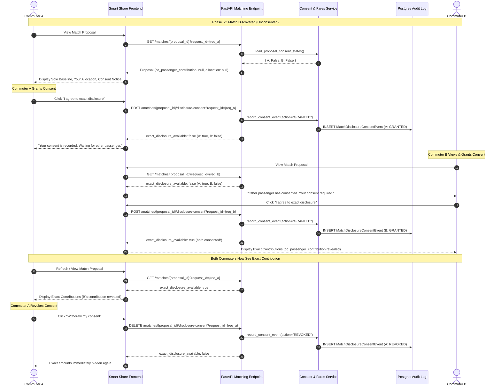

# Phase 6A Bilateral Consent Workflow — Integration Report

**Status:** Integrated Locally (Hosted Acceptance Pending)  
**Date:** November 9, 2026  

---

## 1. System Integration & Workflow Lifecycle



---

## 2. API Contract Payloads

### 2.1 Unconsented or Unilateral State
```json
{
  "data": {
    "consent_text_version": "DEC-013-2026-11-08-v1",
    "consent_notice": "If you consent, the other rider will see your exact contribution...",
    "your_consent_active": true,
    "co_passenger_consent_active": false,
    "exact_disclosure_available": false,
    "allocation": null,
    "conditional_scenarios": []
  },
  "message": "Your exact disclosure consent has been recorded."
}
```

### 2.2 Bilateral Active State
```json
{
  "data": {
    "consent_text_version": "DEC-013-2026-11-08-v1",
    "consent_notice": "If you consent, the other rider will see your exact contribution...",
    "your_consent_active": true,
    "co_passenger_consent_active": true,
    "exact_disclosure_available": true,
    "allocation": {
      "policy": "PROPORTIONAL_TO_SOLO_BASELINE",
      "shared_total": 240.0,
      "shared_total_paise": 24000,
      "your_contribution": 133.33,
      "your_contribution_paise": 13333,
      "co_passenger_contribution": 106.67,
      "co_passenger_contribution_paise": 10667,
      "your_savings": 16.67,
      "your_savings_paise": 1667,
      "your_savings_percent": "11.1100"
    },
    "conditional_scenarios": []
  },
  "message": "Exact disclosure consent status retrieved."
}
```

---

## 3. Hosted Two-User Acceptance Checklist

- [x] Local integration verified (9 backend integration tests passing).
- [x] Local frontend component workflow verified (6 Vitest tests passing).
- [x] DEC-013 privacy gating verified against accidental serialization leaks.
- [x] Sum conservation ($S_A + S_B \equiv F_{\text{shared}}$) preserved in both paise and rupees.
- [x] Driver gross fare remains untouched across all consent transitions.
- [ ] Deploy migration `c5d013c0a501` to hosted Supabase database (after PO approval).
- [ ] Authenticate two live user sessions on hosted environment.
- [ ] Confirm real-time mutual consent toggles co-passenger contribution on both mobile/desktop screens.
